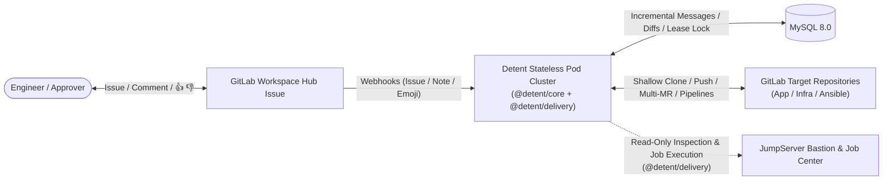

<div align="center">

# Detent

**Stateless GitLab Issue-to-Claude-Code Runtime & Governed AI Change Delivery Control Plane**

*Named after the mechanical stop on an aircraft throttle before ignition — in Detent, production changes require explicit human confirmation before execution.*

[](https://github.com/hallucination-studio/detent/actions/workflows/ci.yml)


**English** | [简体中文](./README.zh-CN.md)

[Features](#key-features) • [Architecture](#architecture) • [Quick Start](#quick-start) • [Issue Workflow](#interactive-issue-workflow) • [Delivery Control Plane](#governed-delivery-control-plane-detentdelivery) • [Documentation](#documentation)

</div>

---

## Overview

**Detent** turns a dedicated GitLab **Workspace Hub Repository** into a stateless, MySQL-backed Claude Code control plane (`1 GitLab Issue = 1 Claude Code Session`) capable of orchestrating changes across multiple repositories, Merge Requests, and governed production environments.

It is built as a **two-package layered monorepo**:

| Package | Role | What It Provides |
| :--- | :--- | :--- |
| **`@detent/core`** | Generic Stateless Runtime | Turns a GitLab CE v18.3.0 Workspace Hub repo into a 100% stateless Claude Code session hub with append-only MySQL persistence, cross-repo `0..N` worktrees & MRs, dual-layer approval gates, and single-comment streaming updates. Zero domain coupling. |
| **`@detent/delivery`** | Governed Production Delivery | Extends `@detent/core` for infrastructure & production change delivery: **GitLab Issue → JumpServer read-only inspection → Ansible MR & human merge auto-resume → second-layer production approval → JumpServer Job Center execution & audit trail**. |

---

## Key Features

- **`1 Issue = 1 Session`, Cross-Project `1:N` Orchestration**
  Decouples an Issue session from a single repository or single MR. Within one Workspace Hub Issue, Claude Code autonomously clones relevant target repositories, manages `0..N` Git worktrees, opens `0..N` Merge Requests across projects, and tracks GitLab Pipelines.
- **Dual-Layer Approval Gates (and Three-Gate Production Compliance)**
  - **Plan Gate (Macro)**: New Issues start in read-only `plan` mode to explore code and post an implementation plan card. Coding begins only after a human reacts with 👍 or comments `/approve`.
  - **Runtime Hook Gate (Micro)**: Integrates with Claude Code `canUseTool`. Routine file reads/writes and built-in `detent_*` tools run smoothly, while risky operations (non-allowlisted `Bash` commands, `AskUserQuestion`) pause and post an approval card controlled via 👍/👎 or `/approve` / `/reject`.
  - **Production Hard Guards (`@detent/delivery`)**: Before running an Ansible job via JumpServer, code-level guards enforce that the target MR is `merged` with a matching `merge_commit_sha`, enforce production approver lists/access levels, and isolate read-only vs. execution credentials.
- **100% Stateless Pods (Zero PVC / Zero Local Disk)**
  Each turn executes inside an ephemeral `/tmp/detent-sandboxes/turn-<uuid>` directory that is deleted (`rm -rf`) immediately after the turn finishes. Across turns, pod restarts, or horizontal scaling, Detent hydrates Claude `.jsonl` history from MySQL and reconstructs multi-repo workspaces via shallow clones plus stored binary `uncommitted_diff` patches.
- **Append-Only MySQL Persistence (Zero Write Amplification)**
  `issue_sessions` stores lightweight metadata and a distributed lease lock (`locked_by_pod`). Conversation history is persisted incrementally in `session_messages` via batched `INSERT IGNORE` — never rewriting full `.jsonl` blobs.
- **Single-Comment Throttled Streaming**
  Each turn edits a single GitLab Issue note via the Edit Note API (throttled to avoid notification spam), wrapping tool traces in collapsible `<details>` blocks while displaying active worktrees, MRs, and pipeline statuses at the bottom.
- **Bot Loop Prevention & Redaction**
  Resolves its own Bot `user.id` at startup (`GET /api/v4/user`) to filter self-triggered webhook events, verifies `X-Gitlab-Token`, and redacts credentials in comments and logs.

---

## Architecture



For full sequence diagrams, MySQL schema, extension contracts, and state machines, see [`docs/DESIGN.md`](./docs/DESIGN.md).

---

## Quick Start

### Prerequisites

- **Node.js** `>= 20.0.0`
- **MySQL 8.0**
- **GitLab CE v18.3.0+** (or compatible GitLab instance)
- **Anthropic API Key** (or compatible gateway via `ANTHROPIC_BASE_URL`)
- *(Optional, for `@detent/delivery`)* **JumpServer** with separate read-only and Job Center credentials

### 1. Install & Build

```bash
git clone https://github.com/hallucination-studio/detent.git
cd detent
npm ci
npm run build
```

### 2. Configure Environment

With Node.js 20.12+ and a GitLab CE instance, `npm run bootstrap` provisions the bot, Hub instructions and labels, project memberships, and webhooks. Export `GITLAB_ADMIN_TOKEN` to create the bot and its PAT, or export an existing `GITLAB_TOKEN` whose user can manage the requested projects, members, and hooks.

```bash
GITLAB_BASE_URL=https://gitlab.example.com \
DETENT_PUBLIC_URL=https://detent.example.com \
DETENT_TARGET_PROJECTS=apps/web,ops/ansible-infra DETENT_HUB_MEMBERS=dev:30,sre:40 \
npm run bootstrap -- --env-out .env
```

The default Hub is `ai/workspace-hub`. Set `DETENT_HUB_PROJECT` to another path or `GITLAB_HUB_PROJECT_ID` to an existing project ID. Bootstrap seeds `CLAUDE.md`, four SOPs under `workflows/`, four Issue templates, and ten labels. Rerunning with the same output file reuses the bot PAT and webhook secret and preserves existing Hub files. Supply MySQL, Anthropic, and JumpServer settings through the environment or edit the resulting mode-0600 file.

For manual GitLab setup, copy [`.env.example`](./.env.example) and fill in your credentials:

```bash
cp .env.example .env
```

Minimum required variables for `@detent/core`:

| Group | Variables |
| :--- | :--- |
| **GitLab** | `GITLAB_BASE_URL`, `GITLAB_TOKEN`, `GITLAB_WEBHOOK_SECRET`, `GITLAB_HUB_PROJECT_ID` |
| **MySQL** | `MYSQL_HOST`, `MYSQL_PORT`, `MYSQL_USER`, `MYSQL_PASSWORD`, `MYSQL_DATABASE` |
| **Claude** | `ANTHROPIC_API_KEY`, `CLAUDE_MODEL` |

### 3. Run the Service

Load environment variables and start either the standalone core runtime or the governed delivery control plane:

```bash
# Standalone Core runtime (@detent/core)
node --env-file=.env packages/core/dist/server.js

# Governed Delivery control plane (@detent/delivery)
node --env-file=.env packages/delivery/dist/server.js
```

### 4. Configure GitLab

1. **Create a Workspace Hub Repository**
   Create a GitLab repository (e.g., `ai/workspace-hub`) to host Issues as Claude sessions and set its Project ID in `GITLAB_HUB_PROJECT_ID`. Place your shared `CLAUDE.md` (team repo catalog, branch conventions, verification rules) and `.claude/` settings at the repository root — see [`examples/hub-workspace/CLAUDE.md`](./examples/hub-workspace/CLAUDE.md) for a template.
2. **Create a Bot Account & Token**
   Create a dedicated bot user (e.g., `@detent-bot`) or Access Token with `api`, `read_repository`, and `write_repository` scopes, and grant at least **Developer** access to the Hub repo and target business repositories.
3. **Configure Project Webhooks**
   In the **Workspace Hub repository** (`Settings -> Webhooks`):
   - **URL**: `http://<your-detent-service>/webhooks/gitlab`
   - **Secret token**: matching `GITLAB_WEBHOOK_SECRET`
   - **Triggers**:
     - ✅ **Issues events** (new Issue starts a session; closing archives the workspace)
     - ✅ **Comments (Note events)** (drives multi-turn `--resume` conversations & slash commands)
     - ✅ **Emoji events** (one-click 👍 `thumbsup` / 👎 `thumbsdown` approvals on cards)
   - **Target Ansible repositories (`@detent/delivery`)**: enable **Merge request events** pointing to the same URL and secret token so merged MRs record the merge SHA and automatically resume the Hub Issue session.
   - *(Optional)* Enable **Pipeline events** on target repositories to sync CI pipeline status back to the Hub Issue.

> **Webhook Queue Note**: Webhook endpoints return `202` once an event is enqueued in the process's in-memory queue. Graceful shutdown drains in-flight events; abrupt process termination may drop unprocessed events.

---

## Deterministic delivery E2E

Both targets run the real bootstrap CLI, Delivery pods and Claude Code binary against MySQL 8.0. A loopback Anthropic SSE server scripts every model turn, and a local JumpServer fixture checks the uploaded playbook ZIP. Use Node.js 20.12+ and installed npm dependencies.

```bash
# Offline GitLab uses Git and git-http-backend
npm run e2e:offline

# Local GitLab CE 18.3.0 with E2E_GITLAB_ADMIN_TOKEN exported
E2E_GITLAB_URL=http://127.0.0.1:8080 npm run e2e:gitlab
```

Set the live URL to the origin GitLab advertises for HTTP clones. Allow the GitLab container to send project webhooks to `host.docker.internal`. For another route, set `E2E_DETENT_PUBLIC_URL` to the address GitLab can reach and `E2E_POD_PORT` to the corresponding host listener port. Each live run leaves its own `e2e-*/workspace-hub` and three target projects for inspection and revokes its temporary tokens.

Bootstrap runs twice and checks nine Hub files, ten labels, hooks, and preservation of credentials and a customized SOP. Both targets exercise the same six scenarios.

1. Unlabeled and missing-capability Issues receive guidance and stay open and idle with zero model requests.
2. Code delivery writes to two repositories. Closure is denied with two open MRs and again with one. The second merge triggers closure and archives both worktrees.
3. A live edit to the release SOP publishes a pinned tag and Release after maintainer approval.
4. A new hotfix SOP publishes only a tag and requires separate production-tier closure approval.
5. Readonly audit verifies nginx on `web01` and closes with zero approval rows.
6. Environment change resumes its plan after a pod restart. A human merges the Ansible MR and approves execution. The suite checks the pinned ZIP, successful execution audit, post-change inspection and empty sandbox.

The two blocked Issues remain open. Each completed workflow verifies GitLab `closed` and `claude::done` alongside MySQL `DONE`.

By default the suite starts a container from a locally cached `mysql:8.0` image. To use an existing local MySQL 8.0 instance, set `E2E_MYSQL_HOST=127.0.0.1`. The optional `E2E_MYSQL_PORT`, `E2E_MYSQL_USER`, `E2E_MYSQL_PASSWORD`, and `E2E_MYSQL_DATABASE` default to `3306`, `root`, an empty password, and `detent`. Use a dedicated test database. The harness creates the Detent tables and removes its session rows during teardown.

## Interactive Issue Workflow

### Issue closure

Hub SOPs select `close_policy: manual | auto | approve`. The default, `manual`, leaves closure to a human. With `auto`, Claude can request closure through `detent_close_issue`. With `approve`, that request also needs a closure card approved at the SOP’s configured tier.

Four guards apply at request time and again at turn completion. A governed plan needs approval, other pending approvals must be resolved, all open session MRs must be merged, and `canCloseIssue` must allow closure. Delivery requires the latest execution to be `SUCCESS` when one exists. The successful turn saves its transcript and workspace, rechecks the guards, posts the final report, archives worktrees, closes the Issue and records `DONE` / `claude::done`.

### End-to-End Example

1. **Open an Issue** in the Workspace Hub repo (e.g., Issue `#42`: *"Upgrade JWT verification to v2 across `backend/order-service` and `infra/api-gateway`"*).
2. **Approve the Plan (Layer 1)**: Detent labels the Issue `claude::planning`, analyzes the target repositories in read-only mode, posts a Plan Approval Card, and switches the label to `claude::waiting-approval`. React with **👍** (or comment `/approve`) to start coding, or reply with feedback to iterate on the plan.
3. **Approve Sensitive Tool Calls (Layer 2)**: Standard workspace edits run automatically. Non-allowlisted `Bash` commands or `AskUserQuestion` prompts post a Tool Approval Card. React with **👍** (`/approve`) to allow or **👎** (`/reject <reason>`) to deny and feed the reason back to Claude.
4. **Multi-Repo MRs & Follow-Up Turns**: Claude pushes branches, creates MRs across target repos, and summarizes links and pipeline status in the comment footer. Keep commenting on the Issue anytime before closing to continue the exact same session seamlessly.

### Commands & Reactions Reference

| Action | Description |
| :--- | :--- |
| **React 👍 on an approval card** | Approve the pending implementation plan or gated tool execution |
| **React 👎 on an approval card** | Reject the pending gated tool execution |
| `/approve [note]` | Approve the pending item with optional additional instructions |
| `/reject <reason>` | Reject the pending item and send the reason back to Claude |
| `/plan [new request]` | Switch the session back to read-only `plan` mode to propose a revised plan |
| `/status` | Display active worktrees, MRs, merge SHAs, delivery audit links, and pending approvals |
| `/abort` | Immediately abort the currently running turn and release the lease lock |
| `/reset` | Clear the Issue's Claude session history and start fresh |
| **Regular comment** | Resumes the Claude Code session (`--resume`) with your comment as the next prompt |

---

## Governed Delivery Control Plane (`@detent/delivery`)

Delivery reads `workflows/*.md` from the Hub default branch on each turn and approval. Each SOP declares its Issue `label`, `mode`, required capability packs (`requires`), and `approver_tier`. Its Markdown body supplies the instructions. To adopt a tag prefix such as `rel-`, edit the body of `workflows/release.md` in the Hub. The next release Issue uses the merged change without application code changes or a pod restart. [Example release SOP](./examples/hub-workspace/workflows/release.md)

| Issue label | Workflow | Required capability |
| --- | --- | --- |
| `delivery::release` | Plan a version, approve the exact tag and commit SHA, and publish | `gitlab-release` (enabled by default) |
| `delivery::code` | Implement and review code across repositories | Built-in workspace tools |
| `delivery::audit` | Inspect assets and report findings in read-only mode | `jumpserver` |
| `delivery::env-change` | Inspect, approve a plan, merge the playbook MR, approve execution, and verify | `jumpserver` |

With the seeded SOPs, an unlabeled Issue receives a menu showing which workflows are ready. If a selected SOP requires a disabled pack, the Issue lists the missing capability, setup instructions, and ready alternatives. Both paths return to `IDLE` before Claude runs. JumpServer is optional for release and code delivery. Set `DELIVERY_ENABLE_RELEASE_TOOLS=false` to disable the release pack.

<details>
<summary><strong>Delivery & JumpServer Environment Variables</strong></summary>

| Variable | Purpose & Default |
| :--- | :--- |
| `JUMPSERVER_BASE_URL` / `JUMPSERVER_ORG_ID` | Enables the JumpServer MCP tools. Organization ID is optional. |
| `JUMPSERVER_READONLY_TOKEN` or `JUMPSERVER_READONLY_ACCESS_KEY_ID` + `JUMPSERVER_READONLY_ACCESS_KEY_SECRET` | Dedicated credentials for asset lookup and read-only inspection. |
| `JUMPSERVER_JOB_TOKEN` or `JUMPSERVER_JOB_ACCESS_KEY_ID` + `JUMPSERVER_JOB_ACCESS_KEY_SECRET` | Physically separate credentials for Job Center execution. |
| `JUMPSERVER_READONLY_ACCOUNT` / `JUMPSERVER_TIMEOUT_MS` | Inspection system account (default: `readonly`) and HTTP timeout (default: `30000` ms). |
| `JUMPSERVER_INSPECT_ALLOW_PREFIXES` | Comma-separated allowlisted read-only command prefixes (see [`.env.example`](./.env.example)); arguments are still validated for read-only safety. |
| `JUMPSERVER_BLOCKED_ASSETS` / `JUMPSERVER_BLOCK_FAILED_PIPELINE` | Blocked asset IDs (default: empty). Failed MR pipelines block execution by default (`false` or `0` to disable). |
| `DELIVERY_PROD_APPROVERS` | Comma-separated GitLab usernames (case-insensitive) allowed to approve production execution; listed users must also meet `GITLAB_MIN_ACCESS_LEVEL`. |
| `DELIVERY_PROD_MIN_ACCESS_LEVEL` | Production approval threshold when `DELIVERY_PROD_APPROVERS` is empty (default: `40` / Maintainer). Plan approval uses `GITLAB_MIN_ACCESS_LEVEL` (default: `30` / Developer). |

</details>

---

## Quality Gates & CI/CD

- **Local Pre-Commit Hook**: Installing dependencies enables [`.githooks/pre-commit`](./.githooks/pre-commit) via `prepare` (or run `git config core.hooksPath .githooks`), executing `npm run check` (`tsc --noEmit` + `knip` dead-code scan + `vitest run`).
- **GitHub Actions CI**: [`.github/workflows/ci.yml`](./.github/workflows/ci.yml) runs typecheck, `knip`, Vitest unit & e2e tests, workspace builds, and ESM export verification on Node.js 20 & 22 for every push and PR to `main`. Optionally enable PR-level OpenCodeReview by setting repository variable `OCR_REVIEW_ENABLED=true` and secret `OCR_LLM_AUTH_TOKEN`.
- **GitLab CI**: [`.gitlab-ci.yml`](./.gitlab-ci.yml) mirrors the verification pipeline and optional MR-level `ocr review` for self-hosted GitLab deployments.
- **OpenCodeReview Rules**: [`.opencodereview/rule.json`](./.opencodereview/rule.json) enforces package boundaries (`@detent/core` vs. `@detent/delivery`), stateless pod invariants, and append-only MySQL rules. Run locally with `npm run review` or in delegate mode per [`AGENT.md`](./AGENT.md).

---

## Project Structure

```text
detent/
├── .github/workflows/ci.yml        # GitHub Actions CI (Node 20 & 22 verify + optional OCR)
├── .gitlab-ci.yml                  # GitLab CI mirror pipeline
├── .githooks/pre-commit            # Local quality gate (typecheck + knip + vitest)
├── .opencodereview/rule.json       # Automated architecture & code quality review rules
├── docs/
│   ├── DESIGN.md                   # Architecture, sequence diagrams & MySQL data model
│   └── IMPLEMENTATION_PLAN.md      # V2 and V3 roadmap & acceptance criteria
├── examples/
│   └── hub-workspace/CLAUDE.md     # Sample Workspace Hub repository CLAUDE.md
├── packages/
│   ├── core/                       # @detent/core — generic stateless runtime
│   │   ├── src/index.ts            # Public API & extension contracts
│   │   ├── src/server.ts           # Standalone server entry (npm start)
│   │   └── tests/
│   └── delivery/                   # @detent/delivery — governed production delivery
│       ├── src/index.ts            # createDeliveryApp assembly entry
│       ├── src/server.ts           # Delivery server entry (npm run start:delivery)
│       └── tests/
├── AGENT.md                        # Architectural invariants & AI agent guidelines
├── README.md                       # English documentation (default)
├── README.zh-CN.md                 # Simplified Chinese documentation
└── .env.example                    # Environment configuration template
```

## Documentation

- **System Architecture & Design**: [`docs/DESIGN.md`](./docs/DESIGN.md) *(Chinese)*
- **Implementation Plan & Acceptance Criteria**: [`docs/IMPLEMENTATION_PLAN.md`](./docs/IMPLEMENTATION_PLAN.md) *(Chinese)*
- **AI Agent Guidelines & Architectural Invariants**: [`AGENT.md`](./AGENT.md) *(Chinese)*
- **Hub Workspace Prompt Template**: [`examples/hub-workspace/CLAUDE.md`](./examples/hub-workspace/CLAUDE.md) *(Chinese)*
