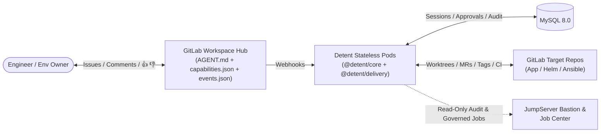

<div align="center">

# Detent

**Stateless GitLab Issue-to-Claude-Code Runtime & Governed AI Delivery Control Plane**

*Named after the mechanical stop on an aircraft throttle before ignition — in Detent, production changes require explicit human confirmation before execution.*

[](https://github.com/hallucination-studio/detent/actions/workflows/ci.yml)


**English** | [简体中文](./README.zh-CN.md)

[Overview](#overview) • [SOP Scenarios](#sop-scenarios) • [Quick Start](#quick-start) • [Commands](#commands--reactions) • [Documentation](#documentation)

</div>

---

## Overview

**Detent** turns a dedicated GitLab **Workspace Hub Repository** into a stateless, MySQL-backed AI engineering and production delivery control plane (`1 GitLab Issue = 1 Claude Code Session`). Workflows (SOPs), environment topologies, approval owners, and event routing live in your Hub repository and take effect immediately without pod restarts.



| Package | Role | Summary |
| :--- | :--- | :--- |
| **`@detent/core`** | Stateless Runtime | GitLab Hub runtime with ephemeral per-turn sandboxes, append-only MySQL history, `0..N` cross-repo worktrees & MRs, MR workers, dual-layer approval gates, and external MCP bridge. Zero domain coupling. |
| **`@detent/delivery`** | Governed Delivery | Adds service releases, environment promotion (`dev -> pre -> prod`), per-environment owners (`@detent-bot` for non-prod vs. named humans for prod), predecessor blocking + Break-Glass, and JumpServer execution/audit. |

### Core Highlights

- **100% Stateless Pods**: Ephemeral `/tmp/detent-sandboxes/turn-<uuid>` sandboxes destroyed after every turn; state and transcripts persist incrementally in MySQL.
- **Governed Approval Pipeline**: Plan approval + per-tool approval cards controlled via 👍/👎, with direct execution (`handoff` / `resume`) after 👍 and fail-closed production guards.
- **Zero-Restart Hub Customization**: Edit `agents/<id>/AGENT.md`, `skills/<name>/SKILL.md`, `capabilities.json`, or `events.json` in GitLab to customize workflows, environment owners, or external MCP tools.

---

## SOP Scenarios

Every built-in workflow has a dedicated guide with **Mermaid flowcharts, sequence diagrams, implementation maps, and customization recipes**:

| Scenario | Trigger / Label | Summary | Guide & Diagrams |
| :--- | :--- | :--- | :--- |
| **Platform Routing & Customization** | All Hub & MR events | Architecture, `ColdHold` / direct-execute state machine, 3-tier customization ladder, `AGENT.md` reference | [**SOP Playbook**](./docs/sops/README.md) |
| **Service Release** | `delivery::release` | Developer-facing release: lock 40-char SHA, Tag/Release, Bot-owned `dev -> pre`, `promotion_gate` (E2E), auto-spawn `prod` follow-up Issue | [**Service Release SOP**](./docs/sops/release.md) |
| **Environment Change & Promotion** | `delivery::env-change` | SRE-facing single-service or whole-env `pre -> prod` promotion, day-2 tuning, independent rollback, predecessor blocking & named Break-Glass | [**Env Change SOP**](./docs/sops/env-change.md) |
| **JumpServer Jobs & Audit** | `jms_job` / `delivery::audit` | Read-only batch inspection (`jms_shell` + optional Jev guard), 5-layer job guards, direct-execute `handoff`, async poller wake-up | [**JumpServer Jobs & Audit**](./docs/sops/jumpserver-jobs.md) |
| **Code Delivery, MR Workers & Onboarding** | `delivery::code`, `@bot` on MR, `agent::onboarding`, `agent::image-sync` | Cross-repo MRs, CI auto-fix workers (`events.json`), self-service repo webhook onboarding, and adding custom SOPs + external MCP packs | [**Other & Custom SOPs**](./docs/sops/other-sops.md) |

---

## Quick Start

### Prerequisites
Node.js `>= 20.0.0`, MySQL 8.0, GitLab CE v18.3.0+, an Anthropic-compatible API key, and optionally JumpServer.

### Build, Bootstrap & Run

```bash
git clone https://github.com/hallucination-studio/detent.git
cd detent
npm ci && npm run build

# Provision bot, Hub SOPs/labels/templates, memberships, and webhooks
GITLAB_BASE_URL=https://gitlab.example.com \
DETENT_PUBLIC_URL=https://detent.example.com \
DETENT_TARGET_PROJECTS=apps/web,ops/ansible-infra DETENT_HUB_MEMBERS=dev:30,sre:40 \
npm run bootstrap -- --env-out .env

# Start governed delivery control plane (or packages/core/dist/server.js for core-only)
node --env-file=.env packages/delivery/dist/server.js
```

For full installation steps, Docker Compose, secrets vault (`DETENT_SECRET_*`), optional Jev risk assessment, and Hub setup, see [**`INSTALL.md`**](./INSTALL.md), [`.env.example`](./.env.example), and [`examples/hub-workspace/`](./examples/hub-workspace/).

---

## Commands & Reactions

| Action | Effect |
| :--- | :--- |
| **👍 / 👎 on an approval card** | Approve or reject a plan, release, onboarding, or JumpServer job card |
| `/approve [note]` · `/reject <reason>` | Text equivalents for approval / rejection with optional context |
| `/help` · `/status` | List live Hub SOPs & readiness (no LLM call) · Show active worktrees, MRs, jobs & pending approvals |
| `/plan` · `/abort` · `/reset` | Re-enter read-only planning · Abort current turn · Reset session history |
| **Regular comment** | Continue the same Claude session (`--resume`) |

---

## Quality Gates & E2E

```bash
npm run check     # tsc --noEmit + knip dead-code scan + vitest run (also in .githooks/pre-commit)
npm run e2e:up    # Start local GitLab + MySQL + JumpServer + K3s test stack
npm run e2e       # Run real-stack SOP E2E scenarios
npm run e2e:down  # Tear down test stack
```

---

## Documentation

- **SOP Scenarios, Flowcharts & Customization (English)**: [`docs/sops/README.md`](./docs/sops/README.md)
- **Installation & Operations Guide**: [`INSTALL.md`](./INSTALL.md) · [`Dockerfile`](./Dockerfile) · [`docker-compose.yml`](./docker-compose.yml)
- **Example Workspace Hub Templates**: [`examples/hub-workspace/`](./examples/hub-workspace/)
- **System Design & MySQL Schema**: [`docs/DESIGN.md`](./docs/DESIGN.md) *(Chinese)*
- **Roadmap & Acceptance Criteria**: [`docs/IMPLEMENTATION_PLAN.md`](./docs/IMPLEMENTATION_PLAN.md) *(Chinese)*
- **Architectural Invariants & Review Rules**: [`AGENT.md`](./AGENT.md) *(Chinese)* · [`.opencodereview/rule.json`](./.opencodereview/rule.json)
