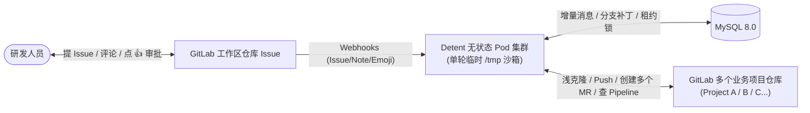

<div align="center">

# Detent

**基于 GitLab CE v18.3.0 的无状态多项目 Claude Code 底座与“受治理 AI 变更交付中枢”**

*Detent 取名自飞机油门杆上点火前的机械止动槽。在这个受治理 AI 变更交付中枢，生产变更同样需要人工确认才能执行。*

[](https://github.com/hallucination-studio/detent/actions/workflows/ci.yml)


[English](./README.md) | **简体中文**

[核心特性](#核心特性) • [系统架构](#系统架构概览) • [GitLab 接入指南](#gitlab-ce-v1830-接入配置指南) • [Issue 交互手册](#issue-内交互使用手册) • [环境配置](#环境配置与目录结构) • [设计文档](#相关文档)

</div>

---

Detent 采用 **双包分层架构**：
- **`@detent/core`（通用基础架构包）**：将一个配置的 GitLab **工作区仓库（Workspace Hub Repository）** 转化为 100% 无状态、纯增量 MySQL 持久化的 Claude Code 会话中枢，实现 **`1 个 GitLab Issue = 1 个 Claude Code Session`**，自由编排跨项目 `0..N` 个 Worktree 与 `0..N` 个 Merge Request，并内置双层审批与单评论流式刷新。
- **`@detent/delivery`（受治理 AI 变更交付中枢）**：基于 `@detent/core` 扩展构建，面向生产环境与基础设施交付，打通 **GitLab Issue 变更工单 → JumpServer 只读账号巡检 → Ansible 脚本提 MR 人工合并自动续跑 → 执行前人工二次审批 → JumpServer 任务中心下发执行与三方审计留痕** 的合规交付闭环。

## 相关文档

- 👉 **双包架构与变更交付设计文档**：[`docs/DESIGN.md`](./docs/DESIGN.md)
- 👉 **实施与验收计划**：[`docs/IMPLEMENTATION_PLAN.md`](./docs/IMPLEMENTATION_PLAN.md)
- 👉 **AI Agent 架构红线与开发规范**：[`AGENT.md`](./AGENT.md)

---

## 核心特性

1. **`1 Issue = 1 Session`，跨项目 `1:N` 自由编排**
   - 配置一个 GitLab **工作区仓库**承载 Issue 会话（并存放全局 `CLAUDE.md`、项目目录规范与公共 Skills）。
   - **彻底解耦 Issue 与单一仓库/单一 MR**：在同一个 Issue Session 中，由 Claude Code 自主决定拉取哪几个 GitLab 业务仓库、创建几个 Worktree（`0..N`）、提交几个跨项目或同项目的 Merge Request（`0..N`），并支持联动 GitLab Pipeline。
2. **双层审批门禁（Dual-Layer Approval Gate）**
   - **宏观需求/方案审批（Plan Gate）**：新建 Issue 默认先进入只读 `plan` 模式探索代码并输出《实施方案审批卡》，人工在 Issue 中点 👍 或回复 `/approve` 后才进入编码执行。
   - **微观运行时工具审批（Hook Gate）**：对接 Claude Code `canUseTool`，编码阶段沙箱内常规文件读写与内置 `detent_*` 工作区工具自动放行，高危操作（如需审批的 `Bash` 命令、`AskUserQuestion`）实时向 Issue 投递【工具执行审批卡片】，支持点 👍/👎 或 `/approve`、`/reject` 控制。
3. **100% 无状态 Pod 架构（Stateless Pod，零 PVC / 零本地磁盘依赖）**
   - Pod 仅在单轮对话执行期使用 `/tmp/detent-sandboxes/turn-<uuid>` 临时沙箱（轮次结束即焚 `rm -rf`）。
   - 跨轮次、跨 Pod 负载均衡或容器重启时，自动从 **MySQL 增量消息表** 水合 Claude `.jsonl` 会话上下文，并从 **GitLab 远端分支 + MySQL `uncommitted_diff` 补丁** 秒级浅克隆还原多项目工作区。
4. **MySQL 纯增量存储（零写放大）**
   - 会话主表 `issue_sessions` 仅存百字节级轻量状态与分布式租约锁（`locked_by_pod`）。
   - 会话消息采用 `session_messages` **纯增量 Append-Only 批量追加（`INSERT IGNORE`）**，绝不覆写整份大字段 JSONL。
5. **单条评论节流流式刷新（防刷屏）**
   - 每轮执行只创建一条评论并通过 GitLab Edit Note API 节流刷新，使用 `<details>` 折叠工具调用链，并实时展示当前 Session 关联的活跃 Worktree 清单与多个 MR/Pipeline 状态。

---

## V6 独立 MR 会话

把打开的 MR 分配给 Bot 可持续处理评审与 CI。在评论中提及 `@bot`（实际 GitLab 用户名）可请求单次协助。Issue 创建的 MR 会自动分配给 Bot。每个 MR 独立维护 Claude 会话，向源分支推送修复，在原讨论串回复行内评审。合并后 MR 会话结束，并唤醒关联的 Hub Issue。

Hub 默认分支的 `events.json` 按首条命中规则选择 `ignore`、`notify`、`run` 或 `semantic`。修改对后续事件即时生效。流水线失败可启动 MR 修复，部署失败可创建 Hub 告警 Issue。执行期间，`session_inbox` 保存新指示，Claude Code 通过 `PostToolUse` 在工具调用后读取，轮末到达的指示可接续下一轮。[策略示例](./examples/hub-workspace/events.json)

| 配置项 | 默认值 | 作用 |
| --- | --- | --- |
| `MR_MAX_AUTO_FIX_ATTEMPTS` | 3 | 每个 MR 的失败流水线自动修复额度（0–10），命中规则可覆盖。 |
| `WATCHDOG_INTERVAL_MS` | 30000 | Watchdog 扫描过期租约和待处理收件箱的基础间隔，带抖动。设为 0 关闭，启用时至少 15000 毫秒。 |
| `WATCHDOG_MAX_RECOVERIES` | 1 | 中断轮次的恢复次数上限（0–5），成功轮次清零。 |

## 系统架构概览



---

## GitLab CE v18.3.0 接入配置指南

### 1 分钟让你的 AI Agent 帮你安装

先准备以下四项。密钥通过本机环境变量或密钥管理器提供。

| 必填项 | 需要准备的参数 |
| --- | --- |
| GitLab 访问 | `GITLAB_BASE_URL` 和用于创建 Bot 的 `GITLAB_ADMIN_TOKEN`，或已有 Bot 的 `GITLAB_TOKEN`（须具备接入权限） |
| Webhook 回调 | `DETENT_PUBLIC_URL`，填写 GitLab 能访问的 Detent 服务根地址 |
| 目标仓库 | `DETENT_TARGET_GROUPS`（群组路径或 ID，包含子群组）或 `DETENT_TARGET_PROJECTS`（项目路径或 ID），多项以逗号分隔 |
| 模型访问 | `ANTHROPIC_API_KEY`，使用网关时可指定 `ANTHROPIC_BASE_URL`，用 `CLAUDE_MODEL` 选择模型 |

| 可选项 | 需要准备的参数 |
| --- | --- |
| Jev | `JEV_PROVIDER`（`bailian` 或 `typesafe`）和 `JEV_API_KEY`。百炼还需提供 `JEV_BASE_URL`。 |
| JumpServer | `JUMPSERVER_BASE_URL`、独立的 `JUMPSERVER_READONLY_TOKEN` 与 `JUMPSERVER_JOB_TOKEN`，也可为两个角色分别配置访问密钥对 |

在仓库目录打开 AI 编程助手，复制以下提示词。

```text
请按当前仓库的 INSTALL.md 安装 Detent，使用我在本机提供的参数。完成预检，
启动 MySQL，运行 bootstrap 接入指定的 GitLab 仓库并启用欢迎工单，再启动并验证
Detent。向我报告 Hub 链接、Bot 用户名和三行使用说明。全程隐藏所有密钥。
```

[安装 SOP](./INSTALL.md) · [Dockerfile](./Dockerfile) · [Compose 服务配置](./docker-compose.yml)

安装后可直接在 Hub 新建 Issue，选择 `onboarding` 模板或添加 `agent::onboarding` 标签，填写项目或群组路径。Bot 需要在每个目标项目拥有 Maintainer 权限。服务端配置 `DETENT_PUBLIC_URL` 和 Webhook 密钥后启用 `gitlab-onboarding`，生产审批人确认后写入 Webhook。在工单或 Bot 受理的 MR 中发送 `/help` 可查看指令。[Hub 使用指南](./examples/hub-workspace/README.md) · [接入 Agent](./examples/hub-workspace/agents/onboarding/AGENT.md)


### 自动配置

使用 Node.js 20.12+ 运行 `npm run bootstrap` 可创建 Bot、初始化 Hub 的 `CLAUDE.md` 与标签，并配置成员和 Webhook。先导出 `GITLAB_ADMIN_TOKEN` 以创建 Bot 及其 PAT，或导出已有的 `GITLAB_TOKEN`，该账号需有管理相关项目、成员和 Webhook 的权限。

```bash
GITLAB_BASE_URL=https://gitlab.example.com \
DETENT_PUBLIC_URL=https://detent.example.com \
DETENT_TARGET_PROJECTS=apps/web,ops/ansible-infra DETENT_HUB_MEMBERS=dev:30,sre:40 \
npm run bootstrap -- --env-out .env
```

默认 Hub 为 `ai/workspace-hub`，可通过 `DETENT_HUB_PROJECT` 指定其他路径，或用 `GITLAB_HUB_PROJECT_ID` 指定已有项目。脚本预置 Hub Agent、Skills、`CLAUDE.md`、`events.json`、Issue 模板及十一个标签。重复运行时保留 Hub 中已有文件，并复用同一输出文件中的 PAT 和 Webhook 密钥。MySQL、Anthropic 和 JumpServer 参数可以通过环境变量传入，也可编辑生成的 `.env`（权限 0600）。构建后执行 `node --env-file=.env packages/delivery/dist/server.js` 即可加载配置并启动交付服务。手动配置步骤如下。

### 1. 准备“工作区仓库（Workspace Hub Repo）”
1. 在 GitLab CE v18.3.0 中创建一个专门用于承载研发会话的工作区仓库（例如 `ai/workspace-hub`），记录其 **Project ID**（填入环境变量 `GITLAB_HUB_PROJECT_ID`）。
2. 在该工作区仓库根目录下可维护全局 `CLAUDE.md`（例如说明团队有哪些业务仓库、各自的职责、分支命名规范与测试要求）以及 `.claude/` 自定义配置。

### 2. 创建 GitLab Bot 账号与 Token
1. 创建一个专用 Bot 账号（如 `@detent-bot`）或使用拥有多项目访问权限的 Personal/Group Access Token（勾选 `api`、`read_repository`、`write_repository` 权限）。
2. 将该 Bot 加入工作区仓库及需要修改的目标业务仓库（角色需至少为 `Developer`）。
3. Detent 启动时会自动调用 `GET /api/v4/user` 识别 Bot 自身 `user.id`，在 Webhook 入口自动过滤 Bot 自身发出的评论和编辑事件，**彻底杜绝无限自环**。

### 3. 配置 GitLab Project Webhooks
在 **工作区仓库** 的 `Settings -> Webhooks` 中添加 Webhook：
- **URL**: `http://<your-detent-service>/webhooks/gitlab`
- **Secret token**: 与 `.env` 中的 `GITLAB_WEBHOOK_SECRET` 保持一致
- **Trigger Events**:
  - ✅ **Issues events**（新建 Issue 自动启动 Claude Code Session，关闭 Issue 自动归档工作区）
  - ✅ **Comments (Note events)**（评论驱动多轮 `--resume` 对话与 `/approve`、`/reject` 等斜杠指令）
  - ✅ **Emoji events**（支持在审批卡片评论上点 👍 `thumbsup` 一键批准、点 👎 `thumbsdown` 一键拒绝）
- 在目标仓库使用相同 URL 和 Secret token，启用 **Merge request、Comments、Emoji、Pipeline、Deployment** 事件。

---

## 确定性交付 E2E

两种模式都使用真实的 bootstrap、Delivery Pod、Claude Code 二进制和 MySQL 8.0。所有模型请求均由本地 Anthropic SSE 服务响应，JumpServer 替身校验上传的 Playbook ZIP。准备 Node.js 20.12+ 和项目 npm 依赖后运行：

```bash
# 离线 GitLab 使用 Git 和 git-http-backend
npm run e2e:offline

# 本地 GitLab CE 18.3.0，预先导出 E2E_GITLAB_ADMIN_TOKEN
E2E_GITLAB_URL=http://127.0.0.1:8080 npm run e2e:gitlab
```

离线套件验证仓库自助接入、安装升级、Issue 工作流、MR Worker、双 Pod 并发以及安全与事件处理。两个 Pod 共用 MySQL，通过回环代理接收 Webhook，验证并行 SDK 轮次、审批与恢复竞争、凭证脱敏和生产变更硬拦截。

真实模式下，GitLab 公布的 HTTP 克隆地址应与 `E2E_GITLAB_URL` 同源。允许 GitLab 容器向 `host.docker.internal` 投递项目 Webhook。使用其他路由时，以 `E2E_DETENT_PUBLIC_URL` 指定 GitLab 可访问的地址，以 `E2E_POD_PORT` 指定对应的宿主监听端口。每次运行保留独立的 `e2e-*/workspace-hub` 和三个目标项目供复核，并撤销临时令牌。

两种模式均重复运行 bootstrap，检查 Hub 文件、标签、Webhook、凭证及客户自定义 SOP，并覆盖六个 SOP 场景和 V6 MR 交互。

1. 缺能力时给出指引，模型请求数为零。无标签的镜像请求经澄清后路由到对应 Agent，审批通过后完成同步。
2. 跨库代码交付生成两个 MR。两个和一个 MR 待合并时均拒绝关单，最后一个合并后关单并归档两个 Worktree。
3. 在线修改发版 SOP，维护者批准后创建锁定 SHA 的 Tag 和 Release。
4. 在线新增热修复 SOP，仅打 Tag，随后须单独获得生产档位的关单审批。
5. 只读巡检确认 `web01` 上 nginx 状态后关单，审批记录为零。
6. 环境变更在 Pod 重启后恢复方案。人工合并 Ansible MR 并批准生产执行，随后校验 ZIP、执行审计、变更后巡检和沙箱清理。

两种模式均检查行内评审、MR 折叠工具轨迹、独立会话收尾，以及外部 MR 的单次提及和分配。离线驱动还模拟 Bot 触发的失败流水线和部署失败，检查分支提交、在线策略切换、轮中指示和 Hub 告警 Issue。

完成的 Issue 流程均检查 GitLab `closed`、`claude::done` 与 MySQL `DONE`。默认使用本地缓存的 `mysql:8.0` 镜像启动容器。如需复用本地 MySQL 8.0，设置 `E2E_MYSQL_HOST=127.0.0.1`。可选的 `E2E_MYSQL_PORT`、`E2E_MYSQL_USER`、`E2E_MYSQL_PASSWORD`、`E2E_MYSQL_DATABASE` 分别默认为 `3306`、`root`、空密码和 `detent`。请使用专用测试库。脚本会创建 Detent 所需的表，结束时清理本次测试的会话数据。

## Issue 内交互使用手册

### 工单闭环

Hub SOP 通过 `close_policy: manual | auto | approve` 选择关单策略。默认 `manual` 由人工关单。`auto` 允许 Claude 通过 `detent_close_issue` 登记关单请求。`approve` 还须通过对应审批档位的关单卡。

申请时和成功轮次末尾均检查四道守卫：受治理流程的方案已批准、其他待审项已处理、会话中无打开的 MR、扩展钩子 `canCloseIssue` 放行。Delivery 有执行记录时要求最新状态为 `SUCCESS`。轮次成功保存 transcript 和工作区后，编排器复核守卫、刷新最终报告、归档 Worktree、关闭 Issue 并同步 `DONE` / `claude::done`。

### 完整工作流示例
1. **提出需求（新建 Issue）**：
   - 在工作区仓库创建 Issue `#42`：
     > **标题**：升级订单服务与网关的 JWT 鉴权协议到 v2  
     > **正文**：需要在 `backend/order-service` 增加 v2 验签接口，并同步修改 `infra/api-gateway` 的鉴权插件，完成后分别提 MR。
2. **审批实施方案（第一层审批）**：
   - Detent 自动打上 `claude::planning` 标签，Claude 分析代码后输出《实施方案审批卡片》，标签变为 `claude::waiting-approval`。
   - 您只需在该条方案评论下 **点一个 👍**（或评论 `/approve`），Claude 立即进入 `claude::coding` 模式；若方案不满意，直接评论修改意见即可让 Claude 重新调整方案。
3. **审批运行时高危工具（第二层 Hook 审批）**：
   - 编码过程中，Claude 常规读写文件自动放行；当执行需审批的 `Bash` 命令或向您提问时，Issue 下会弹出【工具执行审批卡片】。
   - 对该卡片 **点 👍**（或评论 `/approve`）即可放行继续；**点 👎**（或评论 `/reject <原因>`）则拒绝执行并将原因反馈给 Claude。
4. **跨项目多 MR 与多轮迭代**：
   - Claude 完成修改后会在 `backend/order-service` 和 `infra/api-gateway` 分别推送分支并创建 MR，将所有 MR 链接与 Pipeline 状态汇总在评论底部。
   - 在 Issue 关闭前，您可以随时继续评论（例如：*“帮我看下 `order-service!108` 的 pipeline 为什么失败了并修一下”*），Claude 会在同一 Session 中无缝续跑。

### 支持的评论指令速查

| 交互操作 | 说明 |
| :--- | :--- |
| **对审批评论点 👍** | 一键批准当前待审的《实施方案》或被 Hook 拦截的工具调用 |
| **对审批评论点 👎** | 一键拒绝当前被 Hook 拦截的工具调用 |
| `/approve [附加说明]` | 批准当前待审项，并可附带补充要求一同传给 Claude |
| `/reject <拒绝原因>` | 拒绝当前待审项，并将拒绝原因传给 Claude 重新规划 |
| `/plan [新需求说明]` | 将当前 Session 切换回只读 `plan` 模式重新输出技术方案 |
| `/help` | 显示 Hub Agent、能力就绪状态，或当前 MR 的指令；无需调用模型 |
| `/use <agent>` | 切换 Hub Agent 并重新规划 |
| `/status` | 查看当前 Session 绑定的活跃 Worktree、所有 MR、合并 SHA、交付执行审计链接及待审批状态 |
| `/abort` | 立即中止当前正在运行的一轮任务并释放租约锁 |
| `/reset` | 清空当前 Issue 的 Claude Session 历史，重新初始化会话 |
| **直接发送普通评论** | 作为新一轮 User Prompt 自动 `--resume` 当前 Claude Code Session |

---

## Webhook 队列

Webhook 返回 `202` 表示事件已进入当前进程的内存队列。正常关闭会等待队列处理完毕，进程异常退出可能丢失尚未处理完的事件。

## 质量门禁与 CI/CD（本地提交前检查 + OpenCodeReview + GitHub Actions / GitLab CI）

1. **本地提交前门禁（Pre-Commit Hook）**：
   - 运行 `npm install` 时会自动执行 `prepare` 脚本启用 [`.githooks/pre-commit`](./.githooks/pre-commit)（也可手动执行 `git config core.hooksPath .githooks`）。
   - 每次提交前自动运行 `npm run check`，串联执行 **TypeScript 类型检查 (`tsc --noEmit`) + 死代码与未用依赖检测 (`knip`) + 全部单元测试 (`vitest run`)**。
2. **推送前代码质量与架构红线审查（OpenCodeReview）**：
   - 仓库已内置 [`.opencodereview/rule.json`](./.opencodereview/rule.json)（开启 `merge_system_rule: true`，自动复用 OCR 内置的 TypeScript 代码质量、死代码、异步与安全规则，并叠加本项目的无状态 Pod 与 MySQL 纯增量架构红线）。
   - 推送前可让 AI Agent 按 [`AGENT.md`](./AGENT.md) 规范通过 **委托模式**（`ocr delegate preview` / `ocr delegate rule`）审查所有变更，或本地直接运行 `npm run review`。
3. **GitHub Actions CI**：
   - [`.github/workflows/ci.yml`](./.github/workflows/ci.yml) 在每次向 `main` 分支推送或提交 Pull Request 时，于 Node.js 20 与 22 矩阵环境自动执行类型检查、死代码检测、单元测试、Workspaces 构建与 ESM 导出校验。
   - 若在 GitHub 仓库 Variables 中开启 `OCR_REVIEW_ENABLED=true` 并在 Secrets 中配置 `OCR_LLM_AUTH_TOKEN`，还会自动执行 PR 级 `ocr review`。
4. **GitLab CE v18.3.0 CI 兜底**：
   - [`.gitlab-ci.yml`](./.gitlab-ci.yml) 在每次 Merge Request 与 `main` 分支推送时自动运行 `npm run check && npm run build`；若在 GitLab CI Variables 中配置了 `OCR_LLM_AUTH_TOKEN`，还会自动执行 MR 级 `ocr review`。

---

## 环境配置与目录结构

### 环境变量
复制 [`.env.example`](./.env.example) 为 `.env` 并按需修改核心配置：
- `GITLAB_BASE_URL` / `GITLAB_TOKEN` / `GITLAB_WEBHOOK_SECRET` / `GITLAB_HUB_PROJECT_ID`
- `MYSQL_HOST` / `MYSQL_PORT` / `MYSQL_USER` / `MYSQL_PASSWORD` / `MYSQL_DATABASE`
- `ANTHROPIC_API_KEY` / `CLAUDE_MODEL`

### 可选 Jev 风控

本地 Bash 先执行确定性硬门禁和静态白名单校验，再由 System One 评估符合条件的命令。只读或 Plan 模式仅放行高置信度的纯只读操作，编码模式还可放行仅影响临时工作区的开发命令。遇到超时、无效响应、低置信度或超出影响上限时，编码模式转人工审批，巡检和只读模式直接拒绝。放行记录写入 Issue 折叠轨迹。

`JEV_PROVIDER` 默认为 `off`，支持阿里云百炼 Decision Model API、TypeSafe 和自托管兼容服务。百炼使用工作区端点和 API Key。密钥由服务端持有，Claude 子进程、日志和评论均隔离脱敏。Delivery 复用同一客户端评估只读巡检，并校验命令、资产和只读账号。方案、发布、生产任务和审批关单继续执行人工授权。[配置示例](./.env.example)

### 启动交付服务

在服务环境中设置配置变量，也可按上文示例用 Node.js 的 `--env-file` 选项读取配置。安装依赖后运行 `npm run build` 和 `npm run start:delivery`，开发时使用 `npm run dev:delivery`。启动时使用 Core 的 MySQL 连接池创建 `delivery_executions` 表。记录关联会话、已合并 MR、执行审批单和 JumpServer 任务，查询任务结果时更新状态、输出摘要和完成时间。

| 配置项 | 用途与默认值 |
| --- | --- |
| `JUMPSERVER_BASE_URL` / `JUMPSERVER_ORG_ID` | 服务地址启用 JumpServer 工具。组织 ID 可选。 |
| `JUMPSERVER_READONLY_TOKEN` 或 `JUMPSERVER_READONLY_ACCESS_KEY_ID` + `JUMPSERVER_READONLY_ACCESS_KEY_SECRET` | 资产查询和巡检凭证。 |
| `JUMPSERVER_JOB_TOKEN` 或 `JUMPSERVER_JOB_ACCESS_KEY_ID` + `JUMPSERVER_JOB_ACCESS_KEY_SECRET` | 独立的任务中心执行凭证。 |
| `JUMPSERVER_READONLY_ACCOUNT` / `JUMPSERVER_TIMEOUT_MS` | 巡检系统账号默认为 `readonly`，请求超时默认为 30000 毫秒。 |
| `JUMPSERVER_INSPECT_ALLOW_PREFIXES` | 逗号分隔的只读命令前缀，默认清单见 `.env.example`。命令参数仍须通过只读校验。 |
| `JUMPSERVER_BLOCKED_ASSETS` / `JUMPSERVER_BLOCK_FAILED_PIPELINE` | 禁用资产 ID 列表默认空。失败流水线默认阻止执行，可用 `false` 或 `0` 关闭。 |
| `DELIVERY_PROD_APPROVERS` | 逗号分隔的 GitLab 用户名，忽略大小写。配置名单时，生产审批人还须达到 Hub 项目的 `GITLAB_MIN_ACCESS_LEVEL`。 |
| `DELIVERY_PROD_MIN_ACCESS_LEVEL` | 名单为空时的生产审批门槛，默认 40（Maintainer）；方案审批沿用普通门槛，默认 30（Developer）。 |

交付服务在每轮及每次审批时重读 Hub 默认分支上的 `agents/<id>/AGENT.md` 及兼容的 `workflows/*.md`。在文件头声明 Issue 标签（`label`）、模式（`mode`）、所需能力包（`requires`）和审批档位（`approver_tier`），正文编写操作步骤。例如在 `agents/release/AGENT.md` 中约定使用 `rel-` 前缀，合并后下一张发版单即可采用新规范，无需改代码或重启 Pod。[发版 SOP 示例](./examples/hub-workspace/agents/release/AGENT.md)

预置的 `delivery::release` 使用默认启用的 `gitlab-release` 能力包，发版审批锁定目标项目、Tag 和完整 SHA。可通过 `DELIVERY_ENABLE_RELEASE_TOOLS=false` 关闭此包。`delivery::code` 使用基础工作区工具。可选的 `jumpserver` 能力包提供 `delivery::audit` 只读巡检和 `delivery::env-change` 环境变更所需的工具。无标签 Issue 可由 Jev 路由或进入澄清。选定流程缺少能力时，编排器会发出配置提示，并在调用 Claude 前回到 `IDLE`。

### 项目结构
```text
detent/
├── .github/workflows/ci.yml        # GitHub Actions CI（Node 20/22 校验 + 可选 OCR 审查）
├── .gitlab-ci.yml                  # GitLab CI 兜底流水线
├── docs/
│   ├── DESIGN.md                   # 完整系统架构、时序图与 MySQL 增量数据模型设计文档
│   └── IMPLEMENTATION_PLAN.md      # V2–V6 实施与验收标准
├── AGENT.md                        # AI Agent 架构红线、现有代码基线与分阶段开发规范
├── README.md                       # 英文主文档（默认）
├── README.zh-CN.md                 # 中文文档
├── .env.example                    # 环境变量配置模板
├── package.json
├── tsconfig.json
└── packages/
    ├── core/
    │   ├── src/index.ts            # 公共 API 与扩展契约
    │   ├── src/server.ts           # 独立服务入口（根目录 npm start）
    │   └── tests/
    └── delivery/
        ├── src/index.ts            # createDeliveryApp 装配入口
        ├── src/server.ts           # npm run start:delivery
        └── tests/
```
