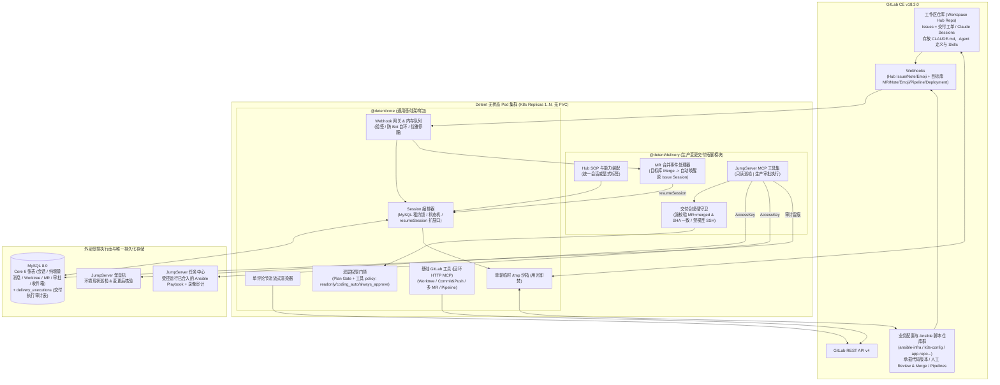
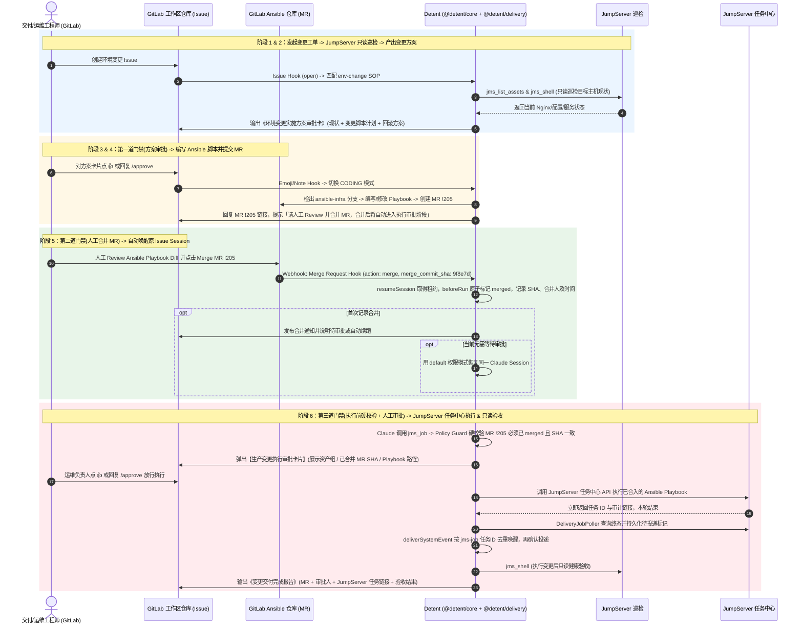
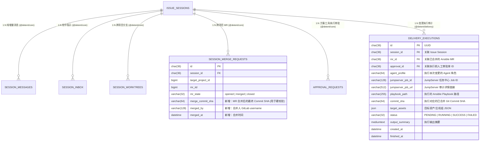

# Detent：双包分层架构与“受治理 AI 变更交付中枢”设计文档

Detent 的名称来自飞机油门杆上点火前的机械止动槽。受治理 AI 变更交付中枢将这一原则落实为执行门禁：生产任务只有在目标 MR 已合并、合并版本校验通过且执行审批获准后才会下发。

> [!IMPORTANT]
> **总体定位**：本项目采用 **双包分层架构（`@detent/core` + `@detent/delivery`）**，并在 V3 演进为 **“硬安全边界由代码兜底 + 软交付流程由 Hub 仓库 SOP 驱动 + 运维能力包可空可插拔”**：
> 1. **`@detent/core`（通用基础架构包）**：将配置的 GitLab CE v18.3.0 **工作区仓库（Workspace Hub Repo）** 打造为 100% 无状态、多项目、纯增量 MySQL 持久化的 Claude Code 会话中枢（Hub Issue 与目标 MR 各自拥有独立 Claude Code Session，解耦 `0..N` 个跨项目 Worktree 与 `0..N` 个 MR，支持双层审批、Hub SOP 加载、可空能力包预检与通用 GitLab Release 工具）。**保持零业务耦合，可独立复用或开源。**
> 2. **`@detent/delivery`（受治理 AI 变更交付中枢拓展模块）**：基于 `@detent/core` 的标准扩展点构建，将 JumpServer + Ansible 封装为**可选/可空能力包（`jumpserver`）**，并随 Hub 模板预置开箱即用的标准交付 SOP（`release` / `env-change` / `code-delivery` / `audit`）。客户可直接编辑 Hub 仓库 Markdown 定制流程，无需 JumpServer 也可独立运行发版与代码交付，或接入自有执行 MCP。

---

## 一、 双包分层架构与模块职责边界

### 1.1 为什么拆分为两个独立 Module（同仓 Monorepo）？

```text
detent/
├── package.json                       # npm workspaces: ["packages/*"]
├── packages/
│   ├── core/                          # @detent/core（通用基础架构包，零 JumpServer/Ansible 等业务耦合）
│   │   ├── package.json
│   │   ├── src/
│   │   └── tests/
│   └── delivery/                      # @detent/delivery（生产变更交付拓展包，依赖 @detent/core）
│       ├── package.json
│       ├── src/
│       └── tests/
├── docs/
│   ├── DESIGN.md
│   └── IMPLEMENTATION_PLAN.md
├── .opencodereview/rule.json          # 按 core 与 delivery 分层守卫代码质量与架构红线
├── .githooks/pre-commit
└── .gitlab-ci.yml
```

| 模块 | 职责定位 | 核心包含内容 | 边界红线 |
| :--- | :--- | :--- | :--- |
| **`@detent/core`** | 通用 GitLab Issue × Claude Code 无状态会话运行时 | • Webhook 网关（验签、防自环、内存队列）<br/>• MySQL 纯增量 `session_messages` 与分布式租约锁<br/>• 无状态 `/tmp` 沙箱（浅克隆 + `uncommitted_diff`）<br/>• 单评论节流流式渲染（`NoteStreamer`）<br/>• Claude SDK 运行器、通用双层审批引擎与基础 GitLab 工具<br/>• 4 个标准业务扩展钩子 | **绝不引入任何业务系统依赖**（不得出现 JumpServer、Ansible、特定 CMDB 等业务词汇或逻辑） |
| **`@detent/delivery`** | 面向生产交付与基础设施变更的受治理 AI 变更中枢 | • **JumpServer 适配器**（单 AccessKey、父进程工具门禁）<br/>• **合规硬守卫（Policy Guards）**：强制校验目标 Ansible MR 已 `merged` 且 SHA 一致；禁止直连 SSH/Ansible<br/>• **GitOps 续跑联动**：监听目标仓库 `merge_request (merge)` 事件自动唤醒原 Issue Session<br/>• **Hub SOP 与工具权限**（环境变更、配置发布、只读排查等）与变更执行审计表 | 所有通用会话、沙箱、MySQL 增量消息与评论渲染均复用 `@detent/core`，不重复造轮子 |

---

### 1.2 整体架构拓扑



---

## 二、 `@detent/core` 基础架构层设计与 4 个标准扩展点

### 2.1 核心底座机制（已在 V1 落地并验证）

1. **`1 Issue = 1 Session`，解耦 `0..N` Worktree 与 `0..N` MR**：
   - `issue_sessions` 主表仅保存轻量元数据、分布式租约锁（`locked_by_pod`、`lock_expires_at`，心跳上限 15s）与消息游标 `last_message_seq`。
   - `session_worktrees`（1:N）与 `session_merge_requests`（1:N）独立关联，支持单 Session 跨多个 GitLab 仓库创建多个分支与多个 MR。
2. **100% 无状态 Pod + MySQL 纯增量存储**：
   - `session_messages` 表按 `(session_id, seq)` 做纯增量 `INSERT IGNORE` 批量追加（绝不在主表存整份 JSONL 大字段）。
   - 单轮运行使用 `${EPHEMERAL_ROOT}/turn-<uuid>` 临时沙箱，`finally` 强制 `rm -rf`；未提交改动以 `git diff --binary` 补丁存入 `session_worktrees.uncommitted_diff`，实现跨 Pod 无缝水合还原。
3. **单评论流式渲染与审批冷挂起**：
   - `NoteStreamer` 节流刷新单条评论并折叠工具轨迹；
   - `PermissionGate` 在暂停前先刷盘 `checkpoint()`，立即终止本轮、清理沙箱并释放租约，审批或回答后在持租约的新进程中恢复。

---

### Jev 语义风控

Core 的 `DecisionClient` 以一次 POST 提交 choice、noul、score 三问，兼容百炼 Decision Model API 和 TypeSafe System One。默认关闭。Bash 硬门禁优先，静态安全命令免网络请求。语义放行要求无外部影响概率达到阈值（默认 0.9），只读模式的影响分上限为 1.2，编码可接受工作区开发类且影响分不超过 1.4。其余结果和网络、协议错误在编码时发审批卡，在只读和 Plan 时拒绝。

Delivery 共享同一实例。只读巡检可在静态白名单外评估诊断命令，要求 pure_readonly、0.75 ≤ noul ≤ 1、0 ≤ impact ≤ 1.35；资产黑名单和账号授权校验始终生效。硬拒绝与静态放行（如 `ss -lntp`）均免 Jev 调用。语义拒绝保留 choice、noul、impact，Jev 默认超时 6000 ms。生产任务、发版、需审批的关单与 Plan 沿用人工审批和权限检查。服务端隔离 Jev 密钥，错误与评论脱敏。

### 2.2 `@detent/core` 暴露的 4 个极简扩展契约（供 `@detent/delivery` 及未来其他模块接入）

为了保持 `@detent/core` 极度紧凑、不引入重型插件框架，仅定义以下 **4 个强类型接口**：

应用通过 `createDetentApp(config, { tools, resolveTurnProfile, hooks, matchWebhookEvent, onInitSchema, onReady, renderStatusExtra })` 装配扩展。各项均可省略，单独启动 Core 使用 `packages/core/src/server.ts`。Core 建立基础表后调用 `onInitSchema(pool)` 初始化业务表，Bot 身份就绪后调用扩展的 `onReady`。Delivery 在该钩子中启动任务扫描，并返回停服时等待扫描结束的清理函数。

#### 扩展点 1：自定义工具与治理级别注册（`DetentExtensionTool`）
```ts
export type ToolGovernancePolicy = 'readonly' | 'coding_auto' | 'always_approve';

export interface ExtensionToolContext {
  session: IssueSessionRow;
  repo: DetentRepository;
  workspaceRoot: string;
  permissionMode: PermissionMode;
  approvalId?: string;
  profileName?: string;
}

export interface DetentExtensionTool<TSchema extends z.ZodRawShape = z.ZodRawShape> {
  name: string;
  description: string;
  schema: TSchema;
  /**
   * - readonly:       plan 与 coding 阶段均可自动放行（如 JumpServer 只读巡检）
   * - coding_auto:    plan 阶段禁止，coding 阶段自动放行（如基础 Git 工具）
   * - always_approve: plan 阶段禁止，coding 阶段强制弹出 GitLab Issue 审批卡片（如生产变更执行）
   */
  policy: ToolGovernancePolicy;
  /**
   * 只读与自动工具在 preflight 中校验一次。强制审批工具在发卡前与批准后各校验一次。
   * 返回 { ok: false, reason } 时直接拒绝，哪怕 LLM 幻觉想跳过前置步骤也无法绕过。
   */
  guard?: (input: z.infer<z.ZodObject<TSchema>>, ctx: ExtensionToolContext) => Promise<{ ok: true } | { ok: false; reason: string }>;
  /**
   * 可选自定义审批卡片 Markdown 渲染器（如展示目标主机组、已合并 MR Commit SHA、JumpServer 模板名）。
   */
  renderApprovalCard?: (approvalId: string, input: z.infer<z.ZodObject<TSchema>>, ctx: ExtensionToolContext) => string | Promise<string>;
  execute: (input: z.infer<z.ZodObject<TSchema>>, ctx: ExtensionToolContext) => Promise<unknown>;
}
```

使用 `defineExtensionTool({ schema, ... })` 定义每个工具，回调的入参类型从该工具的 Zod Schema 推导。返回的工具可放入同一个 `readonly AnyDetentExtensionTool[]`。对于获批的 `always_approve` 调用，执行前复检和执行函数均收到对应审批记录的 `ctx.approvalId`。

#### 扩展点 2：外部 Webhook 事件扩展与受控会话唤醒（`resumeSession`）
- `SessionOrchestrator.resumeSession(sessionId: string, prompt: string, options?: { permissionMode?: PermissionMode; beforeRun?: (session: IssueSessionRow) => Promise<boolean> })`：
  - 取得租约并重读会话后先执行 `beforeRun`。返回 `false` 时直接释放租约。返回 `true` 或省略回调时继续检查待审状态，再设置权限模式并启动轮次。
  - 租约占用时抛出 `SessionBusy`，等待方案或工具审批时保留待审状态并拒绝续跑。
  - 受分布式租约锁保护的公开入口，供业务模块在收到外部事件（如目标仓库 **MR 被人工合并**、告警触发）后唤醒对应的 Hub Issue Session。
- 异步任务完成后，扩展通过 `deliverSystemEvent(sessionId, eventId, content)` 将结果写入收件箱。事件按会话与 ID 去重，忙碌或待审会话保留消息。
- 通过验签和 Bot 过滤的非内置事件交给同步匹配器 `matchWebhookEvent(event)` 校验。返回 `null` 时，网关将事件提交到队列评估 Hub 策略并响应 202；未配置策略匹配器时响应 200 和 `{ ignored: true }`。返回 `{ key, handle(orchestrator) }` 时，网关提交到与内置事件共用的 WebhookQueue 后即响应 202。队列按 eventId 去重，同一 key 串行，遇到 `SessionBusy` 退避重试。停服时中断退避并等待在途处理结束。

#### 扩展点 3：SOP 与审批人策略解析（`TurnProfileResolver`）
轮次启动与审批授权均调用 `resolveTurnProfile({ session, repo, gitlab })`。`gitlab.getIssue(project, iid)` 提供 Issue 的 ID、IID、标题、描述、标签和状态，供扩展按标签选择角色。`gitlab.hasApprovalPermission(project, userId, minAccessLevel?)` 可用于复用项目成员权限检查。

```ts
export interface TurnProfile {
  name?: string;
  readonly?: boolean;
  /** 追加到 System Prompt 的业务规范（如环境变更规范、JumpServer 约束说明） */
  extraSystemPrompt?: string;
  /** 本次会话允许启用的扩展工具白名单（按 Agent 角色最小权限裁剪） */
  enabledExtensionTools?: string[];
  /** 是否禁用 Claude 内置 Bash 工具（例如高敏感交付 Agent 禁止直接执行任意 Shell） */
  disableBash?: boolean;
  /** 自定义审批人权限校验（例如生产变更要求 Maintainer 或指定 SRE 用户名单） */
  canApprove?: (params: { projectId: number; userId: number; username: string; approvalType: ApprovalType; toolName: string }) => Promise<boolean>;
}
```

#### 扩展点 4：审计生命周期回调（`SessionLifecycleHooks`）
- 审批记录从 PENDING 更新为 APPROVED、REJECTED 或 EXPIRED 后，成功写入决策的一方调用 `onApprovalResolved(approval, session)`。
- 每个成功完成的轮次在消息、工作区和最终会话状态保存后调用 `onTurnCompleted(session, result)`，其中 `result` 是本轮最终文本。钩子异常写入脱敏日志，审批和轮次按已保存的结果继续。

---

## 三、 `@detent/delivery`：受治理 AI 变更交付中枢详细设计

### 3.1 生产环境变更 6 阶段端到端闭环



---

### 3.2 `@detent/delivery` 内置的 JumpServer MCP 工具集与安全护栏

| 工具名 | 绑定凭证 | 治理级别 (`policy`) | 强制守卫 (`guard`) | 功能说明 |
| :--- | :--- | :--- | :--- | :--- |
| `jms_list_assets` | Hub AccessKey | `readonly` | 仅限查询已授权节点/主机组 | 按搜索词或节点查询已授权资产的 ID、名称与地址 |
| `jms_shell` | Hub AccessKey | `readonly` | 硬拒绝危险命令，校验允许前缀或通过 Jev 只读判定（禁止写/改/删命令） | 通过 commands 数组按授权账号批量执行只读巡检（如查配置、端口、进程、磁盘、健康检查） |
| `jms_job` | Hub AccessKey | **`always_approve`** | **1. 硬校验对应 Ansible MR 在 MySQL 中已 `merged` 且 `merge_commit_sha` 匹配**<br/>**2. 校验目标资产组不在黑名单**<br/>**3. 审批前与放行后双重校验** | 通过 JumpServer 任务中心（Ops Job Center）下发指定仓库、指定已合并 Commit 的 Ansible Playbook 任务，并通过注入的 tracker 记录实际执行 ID |
| `jms_job_status` | Hub AccessKey | `readonly` | 必须由 tracker 确认本 Session 拥有任务 ID；未配置则拒绝 | 按需查询 JumpServer 任务中心执行状态、标准输出摘要及 JumpServer Web 审计链接 |

通过 `npm run e2e:smoke` 验证异步提交、回调核验和关单。终态与 `callback_pending` 在同一次更新中提交。投递失败后重新扫描终态行并使用已保存的摘要，收件箱按会话和事件 ID 去重。

Stage 3 通过 `createDeliveryApp(config, options)` 装配。Hub 配置服务地址和 `auth` 后启用四个工具。默认使用同一 AccessKey 做 HMAC-SHA256 签名。未配置 Hub 条目的旧部署仍可使用环境变量为两个角色分别指定凭证。巡检与 Playbook 均校验资产账号，并发送 `runas` 和 `runas_policy=skip`。

执行前重读当前会话的 MR，默认拦截失败流水线。HTTP 客户端按合并 SHA 下载 GitLab ZIP，将指定相对路径作为私有 Playbook 的入口，保留同一提交中的角色、文件和相对引用。归档下载及解压各限 64 MiB。GitLab 凭证仅用于 GitLab 请求。任务变量遵循 Job Center 的 `jms_` 命名空间，例如参数 `version` 在 Playbook 中为 `jms_version`。审批卡渲染时从仓储重读 MR。默认追踪器使用共享 MySQL 连接池写入交付审计。

> [!CAUTION]
> **四重防绕过安全机制（Defence in Depth）**：
> 1. **父进程工具门禁**：JumpServer AccessKey 仅由服务端使用。只读流程隐藏执行工具，巡检命令通过硬拦截和只读判断后才能提交。生产执行须通过 prod 审批。
> 2. **禁止裸连 SSH / 本地直跑 Ansible**：交付类 Agent（如 `env-change SOP`）默认禁用或严格限制 `Bash`（禁止 `ssh`、`scp`、`ansible`、`ansible-playbook` 直连命令），所有环境触达必须走 JumpServer 工具。
> 3. **代码硬校验 MR 已合并**：即使 Prompt 提示词被绕过，只要目标 Ansible MR 还没在 GitLab 上真实 `merged`，`jms_job.guard()` 会直接以硬代码拒绝执行。
> 4. **三方审计闭环**：每一次生产变更在 MySQL `delivery_executions` 表中将 **GitLab Issue（工单与审批人） + GitLab MR（已合并的 Ansible Commit SHA） + JumpServer Job ID（执行日志与堡垒机审计记录）** 强关联存证。

---

### 3.3 会话权限解析

显式流程标签使用对应 SOP 的能力、账号、命令前缀、审批等级和关单策略。缺少必需能力时，编排器在创建沙箱前发布配置指引并回到 `IDLE`。工具审批按当前 Hub 配置复核授权。生产工具与生产级能力包使用名单加项目权限门槛，名单为空时按生产权限等级核验。方案审批使用普通项目权限。

## 四、 MySQL 8.0 数据模型增量演进

V6 使用六张 Core 表和一张 Delivery 审计表。交付审计关联会话、MR 与批准的工具执行。



`delivery_executions` 使用 InnoDB，与 Core 外键使用相同的 `utf8mb4_bin` 排序规则。共享池初始化完成后登记提交时的角色、目标资产、Playbook 和合并 SHA。`(session_id, jumpserver_job_id)` 唯一标识会话中的任务，`(session_id, created_at)` 支持按时间列出审计记录。结果查询保存状态与摘要，首次进入 SUCCESS 或 FAILED 时保存毫秒级完成时间。`/status` 在状态和 MR 摘要下显示已有执行记录、关联审批单与任务链接。

---

## 五、 V3 架构演进：Hub 仓库 SOP 驱动与可空能力包（方案 A）

### 5.1 设计动机与核心边界

企业交付流程千差万别（例如发版策略可能是“合并 `main` 后直接打 tag”，也可能是“拉 `release/vX.Y` 改版本号再合并打 tag”；运维执行面可能是 JumpServer + Ansible，也可能是纯 GitLab CI / ArgoCD / 自研发布平台）。V3 将 **“硬安全门禁”** 与 **“软业务流程”** 彻底解耦：

| 层次 | 承载位置 | 职责边界 | 变更方式 |
| :--- | :--- | :--- | :--- |
| **Layer 3：软交付流程（SOP）** | **GitLab Hub 仓库**（`CLAUDE.md`、`agents/<id>/AGENT.md`、`.gitlab/issue_templates/*.md`） | 分支/Tag 策略、前后置检查清单、MR 编排步骤、回滚与报告格式、自定义新流程（如 `agents/hotfix/AGENT.md`） | 客户直接编辑 Hub 仓库 Markdown 并合并到受保护默认分支，**下一轮立即生效、零发版、自带 Git Review 审计** |
| **Layer 2：可空能力包（Capability Packs）** | `@detent/core`（`gitlab-release`）+ `@detent/delivery`（`jumpserver`）+ 用户扩展（`capabilities`） | 封装外部系统原子工具及其**工具级硬守卫**；**所有非基础能力均可空**，未配置即不注册，不向未启用客户暴露无关提示词 | 通过环境变量按需开启，或通过 `DetentCapabilityPack` 接入自有工具 |
| **Layer 1：硬治理底座** | `@detent/core` 编排器与 `PermissionGate` | 无状态 Pod、MySQL 增量持久化、Plan 门禁、`always_approve` 审批卡、RBAC 审批人校验、能力/SOP 缺失预检与 Issue 提示、Hub 治理文件写保护 | 平台代码保障，**不可被 Markdown SOP 弱化或绕过** |

### 5.2 Hub SOP 契约

每个 `agents/<id>/AGENT.md` 声明 label、mode、requires、approver_tier、close_policy，可指定 account、allow_prefixes 和 shared_skills。正文描述操作步骤。私有 Skill 位于该目录的 skills/ 下；共享 Skill 位于 Hub 根目录的 skills/ 下。bootstrap 递归补齐缺失文件。沙箱跳过符号链接，对 Hub 规范和配置实施写保护。

无流程标签的 Issue 使用一个工程会话。主会话按索引读取 `agents/<id>/AGENT.md` 和相关 Skill，直接调用已就绪的工具。只读诊断结束后汇报证据并进入 `IDLE`。变更通过 `detent_submit_plan` 登记方案，进入 `WAITING_PLAN`，用户在 GitLab 点 👍 批准后继续实施。

父进程按三档执行工具门禁。

- `readonly` 允许方案阶段和实施阶段使用。
- `coding_auto` 在方案批准后开放。
- `always_approve` 要求单次工具审批，生产工具额外校验生产审批人。

模型代理在父进程脱敏并认证请求，向上游发送 Messages 和 token 计数请求前，将模型名统一为配置的 `CLAUDE_MODEL`。

## 六、 V4 架构演进：Issue 自动闭环终止条件与全 SOP 确定性验收

### 6.1 设计原则：将“轮次结束（`IDLE`）”与“工单闭环（`DONE` / `closed`）”解耦

在多轮审批与跨库 MR 协作场景下，单轮结束（`IDLE`）往往只是在等待人工 Review、合并或追问，**绝不能在每轮结束后无条件关闭 Issue**；但当需求与当前 Hub SOP 的全部验收条件都已满足时，工单也不应长期滞留在 `Open` 状态。

V4 通过 **3 层组合机制** 实现安全可控的 Issue 闭环：

1. **新增状态与标签**：`SessionStatus` 新增 `'DONE'`，对应 GitLab 状态标签 `claude::done`（清晰区分等待中的 `claude::idle` 与已闭环的 `claude::done`；人工手动关闭 Issue 同样同步为 `DONE` / `claude::done`）。
2. **Hub `agents/<id>/AGENT.md` 声明关闭策略（`close_policy`）**：
   - `close_policy: manual`（未声明时的默认保守策略）：不向 Claude 暴露关单工具，只能由人工手动关闭 Issue。
   - `close_policy: auto`：向 Claude 暴露 `detent_close_issue({ summary })`；满足代码硬守卫后，在**本轮末尾原子收口关闭**。
   - `close_policy: approve`：向 Claude 暴露 `detent_close_issue({ summary })` 且治理策略为 `always_approve`；通过代码硬守卫后弹出【工单闭环关闭审批】卡，需人工点 👍 或 `/approve` 才在轮次末尾关闭。
   - 4 套内置标准 SOP（`audit`、`release`、`env-change`、`code-delivery`）默认配置 `close_policy: auto`，并在 SOP 正文写明各自的业务终止条件；用户可直接改为 `approve` 或 `manual`。
3. **代码层硬守卫与轮次末尾延迟原子关闭**：
   - **`detent_close_issue` 硬守卫（不可被 LLM 幻觉绕过）**：
     1. 非 `readonly` 流程在 `permissionMode === 'plan'` 阶段（方案尚未批准）严禁关单；
     2. 存在其他 `PENDING` 审批请求时严禁关单；
     3. 当前会话在 `session_merge_requests` 中只要还有任意一条 `mr_state === 'opened'` 的未合并 MR，严禁关单（防止刚提 MR 就误关）；
     4. 支持扩展钩子 `canCloseIssue({ session, repo })`：`@detent/delivery` 校验若本会话存在 `delivery_executions` 记录且最新一条状态非 `SUCCESS`，严禁关单。
   - **延迟原子收口**：`detent_close_issue` 在轮次中仅记录待关闭请求；只有本轮 Claude 正常结束且未抛错时，编排器按序完成 **增量落库 transcript → 保存工作区检查点 → 复核关单守卫 → 归档全部活跃 Worktree → 刷新最终评论 → 调用 GitLab `closeIssue`（`state_event: 'close'`）→ 状态置为 `DONE` 并打上 `claude::done`**。Bot 自身关闭触发的 `issue (close)` Webhook 被 `isBotUser` 自动忽略，零自环；人工后续在 GitLab 点 Reopen 并发表评论可无缝恢复会话。
   - **已闭环会话防误唤醒**：`@detent/delivery` 的 MR 合并处理器对已处于 `DONE` 的会话记录合并信息但不再自动拉起新轮次。

### 6.2 全 SOP 确定性 Mock-LLM 验收体系（双目标模式）

为避免依赖外部模型 API，E2E 采用本地确定性 Mock Anthropic SSE 服务驱动真实 `@anthropic-ai/claude-code` 进程。双目标复用同一套场景，V5 扩展见第七节。
- **`npm run e2e:offline`**：离线 GitLab（含真实 `git-http-backend`）+ 离线 JumpServer + Mock Anthropic + 真实 MySQL 8.0 Docker + 真实 `bootstrap.ts` + 真实 `packages/delivery/dist/server.js`。
- **`npm run e2e:gitlab`**：直连真实本地 GitLab CE v18.3.0（如 `http://127.0.0.1:8080`）+ 真实 MySQL 8.0 + Mock Anthropic + Mock JumpServer，零模型 API 费用、100% 确定性验收真实 GitLab API/Webhook/Tag/Release/Issue 自动闭环。

---

## 七、外部 MCP 能力包

### 声明式外部 MCP 能力包

`createDetentApp` 在启动时读取 `DETENT_MCP_CAPABILITIES_FILE`，通过 Streamable HTTP 初始化外部 MCP 会话、发现工具并转换其输入 Schema。以下部署示例用环境变量为注册表工具提供凭证。

```json
{
  "capabilities": [
    {
      "name": "harbor-sync",
      "approverTier": "prod",
      "transport": {
        "type": "streamable-http",
        "url": "https://mcp.example.com/harbor",
        "headers": { "Authorization": "Bearer ${HARBOR_SYNC_TOKEN}" }
      },
      "toolPolicies": { "check_image_exists": "readonly" }
    }
  ]
}
```

Agent 通过 `requires: [harbor-sync]` 启用本包，工具以 `<包前缀>__<工具名>` 注册到 Detent 回环 HTTP MCP。上例中 `harbor-sync__check_image_exists` 可在 Plan 调用，未指定策略的 `harbor-sync__sync_image` 默认 `always_approve`，在 Coding 阶段通过工具审批后才调用远端。`toolPolicies` 可覆盖 `defaultPolicy`，工具仍通过既有门禁。缺失凭证、初始化失败或工具名冲突会禁用对应能力包，经 `setupHint` 提供引导。

请求头在服务端展开。代理在工具元数据、审批卡片、工具结果和错误返回前脱敏，外部凭证不传给 Claude Code。Delivery 重读当前 Agent 验证工具仍启用，并对 `approverTier: prod` 包的工具执行生产审批权限校验，即使 SOP 指定 `approver_tier: standard`。Plan 保持普通项目审批权限。示例 `image-sync` 默认 `requires: []`，可通过 GitOps 清单 MR 与 CI 完成同步，也可配置此能力包。[镜像同步 Agent](../examples/hub-workspace/agents/image-sync/AGENT.md)

### 集成验收

镜像同步用例在 GitLab 和 MySQL 验证私有 Skill、只读 MCP 查询、生产工具审批、凭证脱敏与关单。

## 八、V6 控制面基础

`issue_sessions` 以会话类型、项目 ID 和资源 IID 唯一标识 Issue 或 MR。旧数据升级为 Issue。主表增加自动修复次数、最近失败的流水线 ID 和恢复次数。MR 默认进入 CODING，使用 default 权限模式。创建 MR 时将已识别的 Bot 加入受理人。

`session_inbox` 以 `(session_id, event_id)` 去重，按递增 ID 在短事务内消费。普通评论先入库再尝试取得租约。SDK 的 PostToolUse 读取当前会话的待处理评论。轮末若有新消息，在同一租约下创建下一轮沙箱。发布最终评论后，只有收件箱为空才结束正常轮次。等待审批的会话保留人工门禁。

Watchdog 以无锁查询发现过期的活跃会话和遗留消息。抢占恢复租约时同时比对扫描到的到期时间。成功轮次清零恢复次数。次数用尽后会话进入 FAILED，旧的待处理消息标为 EXPIRED，GitLab 评论提示用户重新发送。定时器在 Fastify 就绪后启动，关闭时等待在途扫描结束。

Hub 默认分支可提供如下 `events.json`。规则按顺序处理，`actionType` 指定处置，此时可用 `action` 匹配 GitLab 操作。省略 `actionType` 时，`action` 直接指定处置。过滤字段支持单个字符串或非空字符串数组，数组内任一值匹配即可。项目和分支支持 `*` 通配符。`semantic` 只向 Jev 发送简短摘要、提示与候选动作，故障时使用 `fallbackAction`，缺省为 notify。

```json
{
  "version": 1,
  "rules": [
    { "event": "release", "action": "create", "actionType": "notify", "notifyTarget": "hub_issue" },
    { "event": ["build", "deployment"], "project": "apps/*", "status": ["failed"], "branch": ["main", "release/*"], "action": "notify", "notifyTarget": "commit" }
  ]
}
```

内置 Issue 与流水线处理优先，已匹配的扩展继续拥有其事件。进入策略处理的事件由 WebhookQueue 加载并评估规则。通知按资源、提交或 Hub 告警 Issue 投递，再调用可选的 `onNotify`。资源缺少 Issue 或 MR 时优先使用提交，缺少提交时创建 Hub 告警 Issue。人为事件带有 actor ID 时，`run` 先校验其在来源项目的审批权限，缺少项目 ID 时校验 Hub 权限。通过后按常规运行流程处理。运行流程将摘要投递到关联的 Hub Issue；缺少关联时创建 Hub Issue，从 Plan 开始。

### 8.1 独立 MR 工作轮次

`MergeRequestOrchestrator` 通过目标项目与 MR IID 查找会话，接单后以 `default` 模式检出源分支。只有 Bot 新增为受理人的更新触发接单。未分配的 MR 通过显式提及请求单次协助。目标项目的成员权限适用于人为接单、评论和审批。评论的文件位置和讨论串 ID 随收件箱持久化。繁忙轮次通过 PostToolUse 读取新指示，回复发回对应讨论串。

MR 轮次可用 Read、Glob、Grep、Edit、Write、Bash、AskUserQuestion，以及以下工具。Bash 复用静态命令与 Jev 风控。跨 Fork 写入要求 Bot 在源项目至少有 Developer 权限，缺少权限时通过 GitLab 评论提供建议。

| 工具 | 作用域 |
| --- | --- |
| `detent_commit_and_push` | 当前 MR 工作树和源分支 |
| `detent_get_pipeline_status`、`detent_get_pipeline_job_log` | MR 或源分支的 CI |
| `detent_get_mr_diff`、`detent_list_mr_discussions` | 当前 MR 的脱敏差异与讨论串 |
| `detent_sync_target_branch` | 在工作树中合入目标项目的目标分支，返回冲突文件 |

每次失败流水线先更新关联 MR 记录，再检查 MR 状态、提交 SHA 和首条命中策略。缺省时自动修复已分配的 MR，向未分配 MR 关联的 Hub Issue 通知失败。自动修复额度与待处理消息在同一事务内持久化，达到上限后在 MR 和关联工单请求人工介入。成功流水线与有效用户评论重置额度。没有匹配 MR 的流水线依 Hub 策略通知或启动 Hub Issue。

MR 完结时终止活跃轮次、作废审批、归档工作树并置 DONE。合并事件的扩展处理器使用独立队列键和事件 ID，关联 Hub Issue 可继续执行原流程。

### V6 MySQL upgrade

`initMySqlSchema` 在启动时创建缺失的表。V5 升级到 V6 时，新表及旧会话索引的变更对应以下 SQL。仅当 `SHOW INDEX FROM issue_sessions WHERE Key_name='hub_project_id'` 返回旧索引时执行第二条语句。已有会话的 `session_kind` 自动取 `issue`。

```sql
CREATE TABLE IF NOT EXISTS session_inbox (
  id BIGINT AUTO_INCREMENT PRIMARY KEY,
  session_id CHAR(36) NOT NULL,
  FOREIGN KEY (session_id) REFERENCES issue_sessions(id),
  event_id VARCHAR(64) NOT NULL,
  source_kind VARCHAR(32) NOT NULL,
  sender_username VARCHAR(128),
  discussion_id VARCHAR(128),
  content MEDIUMTEXT NOT NULL,
  status VARCHAR(16) NOT NULL DEFAULT 'PENDING',
  created_at DATETIME(3) NOT NULL DEFAULT CURRENT_TIMESTAMP(3),
  consumed_at DATETIME(3),
  UNIQUE(session_id, event_id),
  INDEX(session_id, status, id)
) ENGINE=InnoDB DEFAULT CHARSET=utf8mb4 COLLATE=utf8mb4_bin;

ALTER TABLE issue_sessions DROP INDEX hub_project_id,
  ADD session_kind VARCHAR(16) NOT NULL DEFAULT 'issue',
  ADD auto_fix_attempts INT NOT NULL DEFAULT 0,
  ADD last_failed_pipeline_id BIGINT NULL,
  ADD recovery_attempts INT NOT NULL DEFAULT 0,
  ADD UNIQUE KEY session_resource(session_kind, hub_project_id, hub_issue_iid);
```

`WATCHDOG_INTERVAL_MS` 默认为 30000，启用时至少 15000，设为 0 关闭。每个实例在基础间隔上加小于 10% 的随机抖动。`WATCHDOG_MAX_RECOVERIES` 默认为 1（0–5），`MR_MAX_AUTO_FIX_ATTEMPTS` 默认为 3（0–10），匹配规则中的 `maxAutoFixAttempts` 可覆盖该 MR 修复额度。

### 8.2 Stage 12 验收

Issue 和 MR 的 NoteStreamer 按调用 ID 在折叠轨迹中逐步更新内置工具、工作区工具与 MCP 扩展的参数和结果（含错误与拒绝原因）。路径保留原样，每次读取单列一步，工具名仅去除前缀 `mcp__detent__`。参数与结果先脱敏再截至 300 字符。超过 60 步时展示首尾各 30 步及省略数量。双目标套件按真实源分支提交、原讨论串回复及 MySQL 会话终态验收。离线失败流水线使用 Bot 身份并提供真实 API 路径查询任务与日志。外部 MR 场景在模型返回下一次工具调用前等待评论进入收件箱，校验 PostToolUse 将评论中的随机标记传递到同一轮提交。部署失败按 Hub 策略创建带标签的告警 Issue。

## Stage 13–14 · 安装、帮助与仓库接入

`Dockerfile` 构建双包服务，`docker-compose.yml` 运行 MySQL 与 Delivery。按 `INSTALL.md` 运行 bootstrap，可按群组（含子群组）发现目标，或通过 `--welcome-issue` 在空 Hub 发布 Bot 自己的欢迎工单。管理员模式先准备 Bot PAT，再创建或打开 Hub，并在该项目授予 `@detent-bot` Owner（50）。仅用 Bot PAT 时校验 Hub 有效成员权限至少为 Maintainer（40）。Hub 文件、标签、Webhook 和可选欢迎工单均由 Bot PAT 写入。新 Hub 直接采用模板 README，已有文件在重跑时保留。目标业务项目和群组授予 Developer（30），保留已有的更高权限。

Hub Issue 的 `/help` 在成员检查后从默认分支加载 Agent，按当前能力包显示就绪状态。MR 的帮助接受 Bot 指派或显式提及，沿原讨论串回复。两者均无模型调用、租约或会话写入。首条 MR 工作评论用持久化的 active_note_id 区分首次接管与后续轮次。

`agents/onboarding/AGENT.md` 请求 `gitlab-onboarding`。只读工具按项目或群组查询 Bot 有效权限，在有管理权限时核验目标事件。写工具先验证全部目标均达到 Maintainer，再由生产审批人审核范围、回调地址及事件。执行时重读目标和权限，以同一 URL 更新或创建 Webhook。服务端从 `DETENT_PUBLIC_URL` 生成回调地址，只在 GitLab API 请求中使用 Webhook 密钥。Claude 通过单轮回环连接调用 Messages API，由父进程添加上游认证头。


Issue 的 `/help` 按当前 Hub 定义列出场景、标签和就绪状态。Issue 与 MR 的 `/status` 显示中文状态和下一步操作。`WAITING_TOOL` 下的普通回复绑定当前 `ASK_USER` 审批记录，校验身份后在新进程中恢复。其他工具仍需审批卡决定。审批解析器接收待审类型与工具名；已移出流程的操作无法通过更高权限放行。生产审批拒绝提示先核验普通成员权限，进程内按审批单和用户去重，最多保留 1024 条记录。

### Stage 15 · Hub 配置与认证边界

`loadConfig` 从进程环境读取形如 `DETENT_SECRET_NAME` 的非空值。全值引用使用 `$secret:NAME`，请求头模板使用 `${secret:NAME}`。模板展开一次，Hub 作者只能引用 vault。原有文件式 MCP 配置保留服务端变量解析规则。

Issue 编排器在帮助、运行和审批时分别加载 Hub 默认分支的 `capabilities.json`。不存在时使用启动配置，文档损坏时关闭能力包。Core 解析通用 MCP，Delivery 通过 `resolveCapabilities` 解释业务配置；运行中的门禁与角色解析共享当前快照。代理发现和执行分别管理连接，SSE 消息端点须与握手地址同源。认证头和密钥只保留在服务端。Hub 的流程扩展字段随选中的 profile 进入工具上下文。

Hub 的 `auth` 引用 `$secret:JMS_AK_ID` 和 `$secret:JMS_AK_SECRET`，供巡检与任务中心共用。先使用流程 `account`，其次使用 Hub `default_account`。两者均未设置时，逐资产按 JumpServer 返回顺序选择首个有效授权账号，跳过停用账号和以 `@` 开头的虚拟账号。巡检按账号分组并汇总结果。单个 Ansible 任务要求所有目标使用同一账号，否则须指定共同的 `account` 或分组执行。缺少有效账号时，错误指出对应资产。执行工具继续核对 MR 合并 SHA、最新流水线及审批记录。

JumpServer 的即时作业与带变量的 Playbook 定义均显式提交 `is_periodic: false`。兼容接口的 HTML 404 分别回退到资产详情的 `permed_accounts` 与 Ansible 执行日志，后者去除 NUL 填充。其他 HTTP 错误在父进程记录状态和脱敏原文，工具轨迹保留短摘要。失败执行写入 `delivery_executions`，最新执行成功后才可自动关单。
