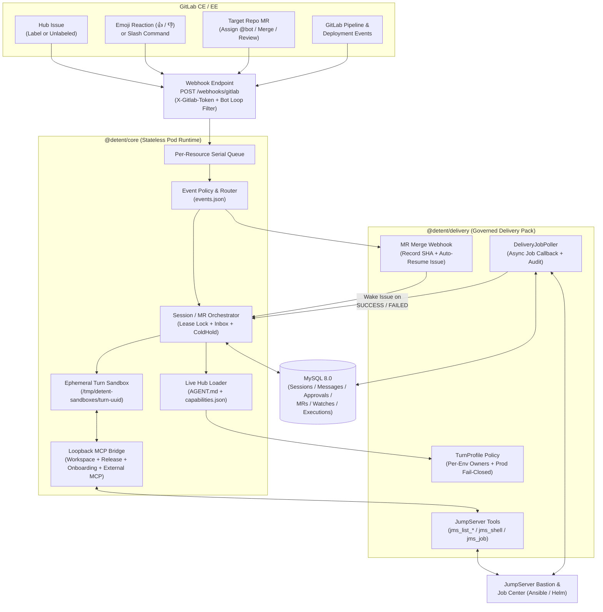
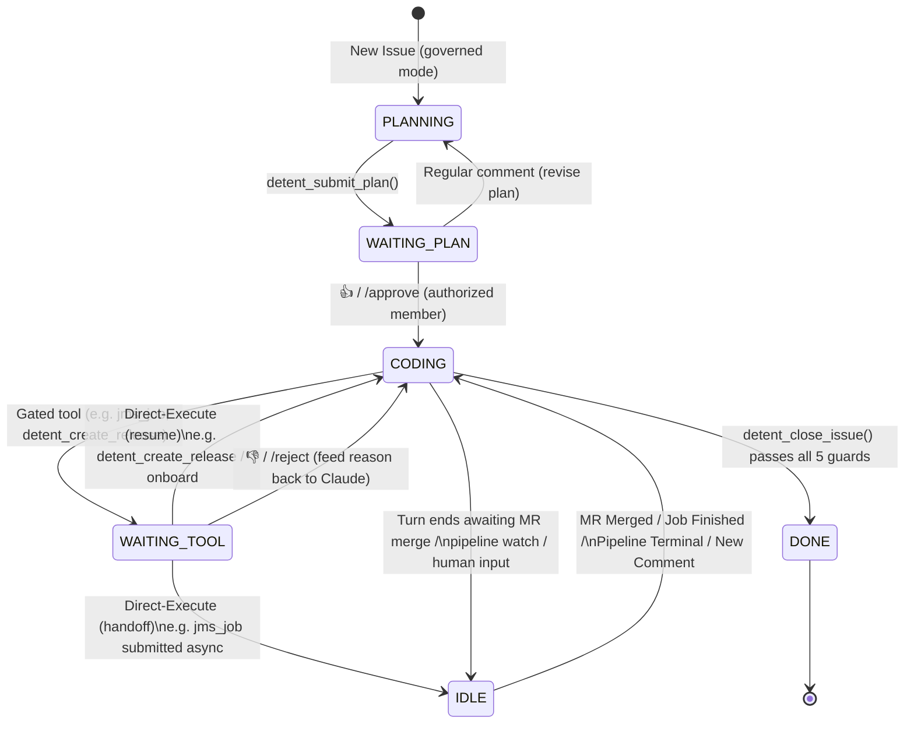
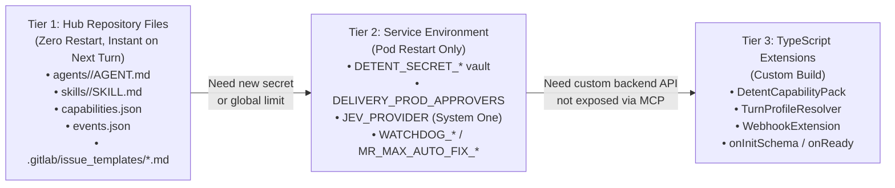

# Detent SOP Scenarios & Customization Guide

Detent turns a GitLab **Workspace Hub repository** into a stateless, policy-governed AI engineering and delivery control plane. Every workflow (SOP) is declared as Markdown + YAML frontmatter in the Hub repository (`agents/<id>/AGENT.md`), paired with live capability configuration (`capabilities.json`) and event routing (`events.json`).

> **Core Design Principle**: Business SOPs, environment topologies, tag conventions, and approval owners live in your **GitLab Hub repository**—read fresh on every turn and every approval vote, with **zero pod restarts or code deploys**.

---

## 1. End-to-End Platform Architecture & Routing



---

## 2. SOP Scenarios Matrix

| Scenario | Trigger / Label | Primary Actors | Key Capabilities | Deep-Dive Guide |
| :--- | :--- | :--- | :--- | :--- |
| **Service Release** | `delivery::release` | Developer (User A), `@detent-bot` (non-prod) | Lock 40-char SHA, Tag/Release (or reuse), `dev` -> `pre` deploy, `promotion_gate` (E2E), auto-spawn `prod` follow-up Issue | [Service Release](./release.md) |
| **Environment Change & Promotion** | `delivery::env-change` | SRE / Platform Owner (User B) | Single-service `prod` follow-up, full-env `pre -> prod` batch release, Helm/Ansible tuning, independent rollback, predecessor blocking + Break-Glass | [Env Change & Promotion](./env-change.md) |
| **JumpServer Jobs & Audit** | `jms_job` / `delivery::audit` | Engineer, Env Owner / SRE | Read-only batch inspection (`jms_shell` + Jev guard), 5-layer pre-execution gate, direct-execute (`handoff`) on 👍, async poller wake-up | [JumpServer Jobs & Audit](./jumpserver-jobs.md) |
| **Multi-Repo Code Delivery** | `delivery::code` | Developer | `0..N` cross-repo worktrees & MRs, multi-MR merge defer, CI status tracking, auto-close after all MRs merge | [Other SOPs](./other-sops.md#1-multi-repo-code-delivery-deliverycode) |
| **MR Workers & Event Routing** | Assign `@bot` / `@bot` mention / `events.json` | Developer, Reviewer | Dedicated MR session, inline review replies, CI auto-fix loop (`MR_MAX_AUTO_FIX_ATTEMPTS`), main-branch failure alerts | [Other SOPs](./other-sops.md#2-mr-workers--event-policy-eventsjson) |
| **Repository Onboarding** | `agent::onboarding` | Platform Admin / Prod Approver | Audit Bot Maintainer permission & missing webhooks, prod-approved webhook setup or new repo creation | [Other SOPs](./other-sops.md#3-repository-onboarding-agentonboarding) |
| **Image Sync & Custom SOPs** | `agent::image-sync` / custom `agent::*` | Engineer, Hub Admin | GitOps mirror MR or external HTTP/SSE MCP capability pack, zero-code custom SOP authoring | [Other SOPs](./other-sops.md#4-image-sync--building-custom-sops) |
| **Unified Ad-Hoc Issue** | *(No label)* | Any Hub Member | Single session with all enabled packs; answers read-only questions directly, requires `detent_submit_plan` + 👍 before any write | [Unified Mode](#3-how-every-turn-executes-coldhold--direct-execute) |

---

## 3. How Every Turn Executes (ColdHold & Direct-Execute)

Detent pods hold **zero local state** between turns. When an approval or external callback is needed, Detent checkpoints the session to MySQL, destroys `/tmp/detent-sandboxes/turn-<uuid>`, and releases the distributed lease lock.



### Two Direct-Execution Modes After 👍

| Mode | Used By | What Happens Immediately After 👍 (Without Waking Claude First) |
| :--- | :--- | :--- |
| **`handoff`** | `jms_job` | Re-validates Hub config, approver, merge SHA, and live assets -> submits JumpServer job directly -> posts job link -> transitions to `IDLE`. Session wakes only when `DeliveryJobPoller` observes `SUCCESS` or `FAILED`. |
| **`resume`** | `detent_create_release`, `detent_onboard_project`, `detent_create_project` | Re-validates Hub config, approver, and tool guard -> executes GitLab API directly -> feeds redacted result immediately into a resumed Claude turn so the workflow continues without an extra round-trip. |

---

## 4. Three-Tier Customization Ladder

Before changing any TypeScript code, check which tier your change belongs to:



### Quick Customization Map

| What You Want to Change | Where to Edit | Restart Required? |
| :--- | :--- | :--- |
| Change tag format, PR checklist, rollout steps, or add a new SOP | Hub `agents/<id>/AGENT.md` | No |
| Add/remove environments (`dev`, `qa`, `pre`, `prod`) or change `promotion_gate` | Hub `skills/env-topology/SKILL.md` | No |
| Switch an environment between `@detent-bot` and human owners (`@sre-alice`) | Hub `capabilities.json` (`jumpserver.environments.<env>.owner`) | No |
| Customize Ansible/Helm layout, lint commands, or host selection strategy | Hub `skills/ansible-conventions/SKILL.md` or `skills/helm-conventions/SKILL.md` | No |
| Plug in an internal tool (Harbor, Jira, ArgoCD, PagerDuty) | Hub `capabilities.json` (`type: "mcp"`, `http` or `sse`) + `DETENT_SECRET_*` | Only when adding a new `DETENT_SECRET_*` |
| Change CI auto-fix / failure alert routing rules | Hub `events.json` | No |
| Control who can approve production tools when no env `owner` is set | Env `DELIVERY_PROD_APPROVERS` / `DELIVERY_PROD_MIN_ACCESS_LEVEL` | Yes |
| Control auto-close behavior (`manual` / `auto` / `approve`) | Hub `agents/<id>/AGENT.md` frontmatter `close_policy` | No |

### `AGENT.md` Frontmatter Reference

Parsed live by [`packages/core/src/workflows/hub-agents.ts`](../../packages/core/src/workflows/hub-agents.ts):

```yaml
---
label: delivery::release           # GitLab Issue label that activates this SOP
mode: governed                     # governed (plan -> approve -> execute) | readonly
requires: [gitlab-release]         # Mandatory capability packs; blocks turn if disabled
uses: ["*"]                        # Optional capability packs visible to the agent
approver_tier: standard            # standard | prod (overrides all tool approvals to prod if prod)
close_policy: auto                 # manual | auto | approve
allow_bash: true                   # Allow local sandbox Bash (always false in readonly mode)
account: deploy                    # Optional JumpServer execution account override
allow_prefixes: ["curl -fsS"]      # Optional extra read-only jms_shell command prefixes
shared_skills: [env-topology]      # Shared skills mounted from Hub skills/<name>/SKILL.md
description: Short summary shown in /help
---
```

---

## 5. Related Documentation

- **Deep-Dive SOP Guides**:
  - [Service Release (`delivery::release`)](./release.md)
  - [Environment Promotion, Tuning & Rollback (`delivery::env-change`)](./env-change.md)
  - [JumpServer Jobs & Read-Only Audit (`jms_job` & `delivery::audit`)](./jumpserver-jobs.md)
  - [Code Delivery, MR Workers, Onboarding & Custom SOPs](./other-sops.md)
- **Installation & Bootstrap**: [`INSTALL.md`](../../INSTALL.md)
- **System Design & MySQL Schema**: [`docs/DESIGN.md`](../DESIGN.md) *(Chinese)*
- **Example Hub Workspace**: [`examples/hub-workspace/`](../../examples/hub-workspace/)
