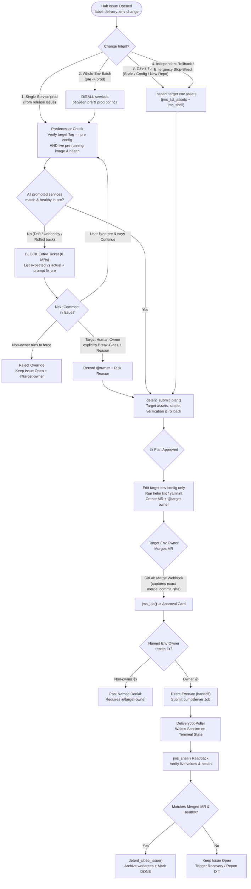
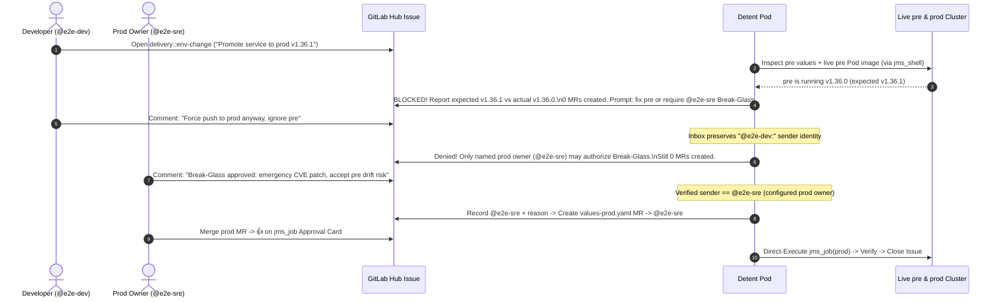

# Environment Promotion, Config Tuning & Rollback SOP (`delivery::env-change`)

## 1. What It Provides

`delivery::env-change` is the **environment-scoped operations & production release ticket** (User B / SRE / Platform Owner). It covers four operational workflows using one unified change pipeline:

1. **Single-Service `prod` Promotion**: Automatically spawned by a completed `delivery::release` Issue (or opened manually) to promote one verified service from `pre` to `prod`.
2. **Whole-Environment Batch Release (`pre -> prod`)**: Compares all services between `pre` and `prod` configuration files in the GitOps/Chart/Ansible repo, checks every changed service against live `pre` health, and promotes the whole batch atomically.
3. **Day-2 Config & Infrastructure Tuning**: Scaling replicas, tuning Nginx/JVM/Ansible parameters, updating Helm values, or provisioning a new ops repository (`detent_create_project`).
4. **Independent Rollback & Emergency Stop-Bleed**: Reverts a single target environment (e.g., `prod`) back to a known stable Tag/config without touching `pre`, skipping forward-promotion predecessor gates.

### Key Safety Guarantees
- **Strict Predecessor Blocking**: Before creating a `prod` (or `pre`) forward-promotion MR, Detent verifies that every service being promoted matches the predecessor environment's config **and** live running pods/workloads, and is healthy. Any drift or unhealthy service blocks the entire ticket with **0 MRs created**.
- **Named Owner Break-Glass Only**: Only the configured **human target environment owner** (e.g., `@sre-alice`) can explicitly override a predecessor block by replying in the Issue with an explicit override instruction and stated risk reason. Regular developers, plan approvals, or second-hand relays are rejected.
- **Review-Safe SHA Binding**: If a human modifies the MR during code review before merging, the Merge Webhook captures the exact `merge_commit_sha` and forces `jms_job` to deploy and verify **that exact merged commit**.

---

## 2. How It Works

### 2.1 Four Entry Modes & Decision Flow



### 2.2 Predecessor Blocking & Named Break-Glass Sequence

This exact flow is verified end-to-end in `SOP12`:



### 2.3 Review-Safe Merge Webhook Auto-Resume

```mermaid
sequenceDiagram
    participant Detent as Detent Pod
    participant GitLab as Target Config Repo (MR !4)
    actor Owner as Env Owner (@sre-alice)
    participant MySQL as MySQL (session_merge_requests)

    Detent->>GitLab: Push branch + Open MR !4 (values-prod.yaml, replicas: 3)
    Detent->>GitLab: Post link + @sre-alice -> Session enters IDLE
    Owner->>GitLab: Reviews MR !4, adjusts replicas: 3 -> 4 directly on MR branch
    Owner->>GitLab: Merges MR !4 -> creates merge_commit_sha = 9f8e7d6c
    GitLab->>Detent: Webhook: merge_request (action=merge, merge_commit_sha=9f8e7d6c)
    Detent->>MySQL: recordMergedMr(state='merged', sha='9f8e7d6c', mergedBy='sre-alice')
    Detent->>Detent: Auto-resume Issue with prompt:\n"Use exact merge_commit_sha 9f8e7d6c; preserve review edits"
    Detent->>GitLab: Call jms_job(commit_sha="9f8e7d6c") -> Approval Card
```

---

## 3. Implementation Map (Under the Hood)

| Component | File | What It Enforces |
| :--- | :--- | :--- |
| **SOP Definition** | [`examples/hub-workspace/agents/env-change/AGENT.md`](../../examples/hub-workspace/agents/env-change/AGENT.md) | `label: delivery::env-change`, `requires: [jumpserver]`, `close_policy: auto`, `shared_skills: [env-topology, gitlab-mr-conventions, ansible-conventions, helm-conventions]`. |
| **Predecessor & Break-Glass Policy** | [`examples/hub-workspace/skills/env-topology/SKILL.md`](../../examples/hub-workspace/skills/env-topology/SKILL.md) | Defines forward-promotion checks, whole-env diffing, blocking rules, and Break-Glass authorization requirements. |
| **Sender Attribution in Inbox** | [`packages/core/src/orchestrator/session-orchestrator.ts`](../../packages/core/src/orchestrator/session-orchestrator.ts) | Always formats pending comments with `@senderUsername:` via `formatInboxMessages` so Break-Glass verifies the true GitLab comment author. |
| **Named Owner Approval & Denial** | [`packages/delivery/src/agents/profiles.ts`](../../packages/delivery/src/agents/profiles.ts) | `canApprove` enforces membership in `environments.<env>.owners` + GitLab project access + live asset match. `formatApprovalDenial` replies with the exact `@owner` mention when someone else clicks 👍. |
| **MR Merge Auto-Resume** | [`packages/delivery/src/webhooks/merge-request.ts`](../../packages/delivery/src/webhooks/merge-request.ts) | Listens to `merge_request` (`action=merge`), persists `merge_commit_sha`, and resumes the Hub Issue (defers wake-up if other MRs are still open in non-`jms_job` sessions). |
| **Closure Guard** | [`packages/core/src/orchestrator/close-issue.ts`](../../packages/core/src/orchestrator/close-issue.ts) + [`packages/delivery/src/index.ts`](../../packages/delivery/src/index.ts) | Blocks `detent_close_issue` unless plan is approved, 0 pending approvals, 0 open MRs, 0 pending pipeline watches, and latest `delivery_executions` row is `SUCCESS`. |

---

## 4. How to Customize It

### 4.1 Add Environments or Reorder Promotion Chain *(Hub Edit, Zero Restart)*
Edit `skills/env-topology/SKILL.md` (e.g., `dev -> staging -> pre -> prod`) and mirror each environment's asset matcher and owner in `capabilities.json` -> `jumpserver.environments`.

### 4.2 Switch Ansible Host Selection from JumpServer Nodes to Repo Inventory *(Hub Edit, Zero Restart)*
Edit `skills/ansible-conventions/SKILL.md` to instruct the agent to parse `inventories/<env>/hosts.yml` and cross-check every host against `jms_list_assets`.

### 4.3 Require Explicit Human Approval Before Closing the Issue *(Hub Edit, Zero Restart)*
In Hub `agents/env-change/AGENT.md`, change frontmatter:
```yaml
close_policy: approve   # Posts a Closure Approval Card instead of auto-closing
# or:
close_policy: manual    # Never closes automatically; human closes manually
```

### 4.4 Enforce Production Approval When No Per-Env `owner` Is Configured *(Server Env)*
If an environment omits `owner` in `capabilities.json`:
- Set `DELIVERY_PROD_APPROVERS=alice,bob` to whitelist specific GitLab usernames (they must also satisfy `GITLAB_MIN_ACCESS_LEVEL`).
- Or leave `DELIVERY_PROD_APPROVERS` empty and control access via `DELIVERY_PROD_MIN_ACCESS_LEVEL` (default `40` / Maintainer).

### 4.5 Enforce Config Repo Review Rules in GitLab *(Target Repo Edit)*
Add `.gitlab/CODEOWNERS` in your Helm/Ansible repository to bind `values-prod.yaml` or `inventories/prod/` to your SRE group so GitLab itself blocks unauthorized merges before Detent ever sees a merge webhook.
