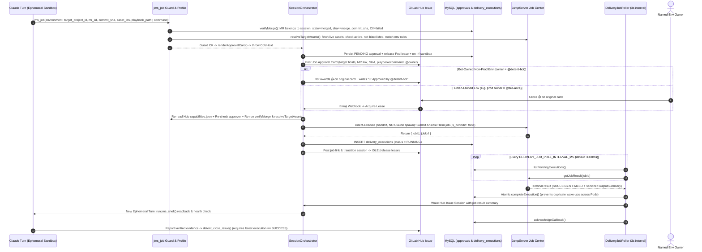
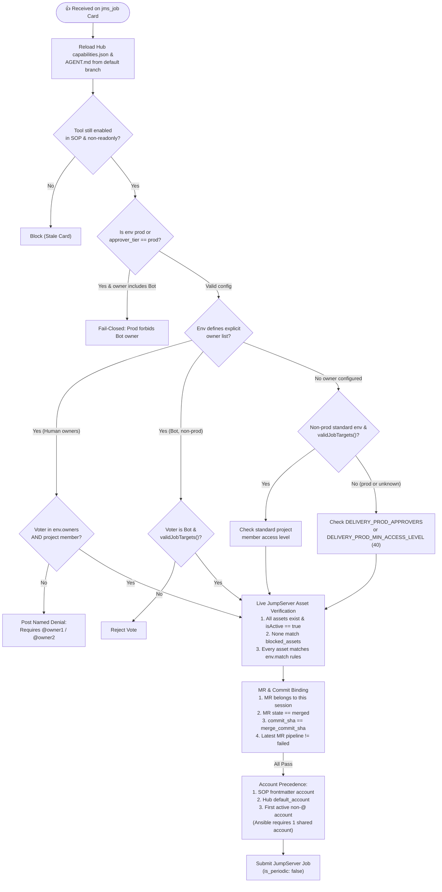

# JumpServer Job Execution (`jms_job`) & Read-Only Audit (`delivery::audit`)

## 1. What It Provides

The `jumpserver` capability pack bridges Detent's GitLab governance with live infrastructure via **JumpServer Bastion & Job Center**—split into two strictly separated tiers:

- **Read-Only Inspection (`jms_list_nodes`, `jms_list_assets`, `jms_shell`, `delivery::audit`)**:
  - Discovers authorized hosts by node tree, labels, or search.
  - Runs batched read-only diagnostic commands (`commands[1..10]`) in a single call, grouping assets automatically by authorized account.
  - Protected by deterministic read-only command prefix filtering + argument safety checks + optional **Jev System-One** risk assessment.
- **Governed Job Execution (`jms_job`, `jms_job_status`)**:
  - Executes either an **Ansible Playbook** (`playbook_path`) or a **Repository Command** (`command`, e.g., `helm upgrade --install`) checked out at the exact merged MR commit SHA (`commit_sha`).
  - Runs **only after** a 5-layer guard passes and the authorized owner (or Bot for non-prod Bot-owned envs) reacts 👍 on the Job Approval Card.
  - Uses **Direct-Execute (`handoff`)**: submits the JumpServer job immediately upon 👍 without launching Claude, tracks execution in MySQL `delivery_executions`, and automatically wakes the Issue once `DeliveryJobPoller` observes `SUCCESS` or `FAILED`.

---

## 2. How It Works

### 2.1 Complete `jms_job` Lifecycle (Approval -> Direct-Execute -> Async Poller -> Verify)



### 2.2 Multi-Layer Security & Permission Decision Tree

Every `jms_job` call passes these gates **twice**: once before posting the Approval Card, and a second time **live** when 👍 arrives (preventing stale-config or race-condition bypasses).



### 2.3 Read-Only Audit (`delivery::audit`) & Command Safety Pipeline

```mermaid
flowchart LR
    Issue(["Hub Issue\nlabel: delivery::audit\nmode: readonly"]) --> Discover["jms_list_nodes()\njms_list_assets(node_id, labels)"]
    Discover --> Batch["Single jms_shell() Call\ncommands: [cmd1..cmd10]\n(max 50 assets, 10 cmds/batch)"]
    Batch --> Guard1["1. Target Asset Check\n(Active + Not Blacklisted)"]
    Guard1 --> Guard2["2. Deterministic Filter\n• No newlines/NUL/shell chaining\n• Prefix allowlist + read-only args"]
    Guard2 --> Guard3{"3. Matches static\nallowlist?"}
    Guard3 -->|"Yes"| GroupAcc["Group Assets by\nAuthorized Account"]
    Guard3 -->|"No & JEV_PROVIDER enabled"| Jev["Jev System-One\nRisk Classifier"]
    Jev -->|"Confident read-only"| GroupAcc
    Jev -->|"Uncertain / Error / Risky"| DenyCmd["Deny Command\n(Fail-Closed in readonly)"]
    Guard3 -->|"No & JEV off"| DenyCmd
    GroupAcc --> Run["Execute via JumpServer\nMerge Redacted Outputs"]
    Run --> Report["5-15 Line Diagnostic Report\n+ detent_close_issue()"]
```



---

## 3. Implementation Map (Under the Hood)

| Component | File | Responsibility |
| :--- | :--- | :--- |
| **Tools & Guards** | [`packages/delivery/src/jumpserver/tools.ts`](../../packages/delivery/src/jumpserver/tools.ts) | Defines `jms_list_nodes`, `jms_list_assets`, `jms_shell`, `jms_job` (`directExecuteOnApproval: 'handoff'`), `jms_job_status`, `verifyMerge()`, `resolveTargetAssets()`, and `renderApprovalCard()`. |
| **Command & Asset Guards** | [`packages/delivery/src/jumpserver/guards.ts`](../../packages/delivery/src/jumpserver/guards.ts) | Validates `playbook_path`, blocks shell metacharacters, matches `blocked_assets` & environment `match` rules, integrates optional Jev classification. |
| **HTTP Client & Pooling** | [`packages/delivery/src/jumpserver/client.ts`](../../packages/delivery/src/jumpserver/client.ts) + [`packages/delivery/src/index.ts`](../../packages/delivery/src/index.ts) | HMAC Signature / Bearer auth, LRU pool of up to 16 `HttpJumpServerClient` instances keyed by config+credential hash, parallel per-asset account lookup, always sets `is_periodic: false`. |
| **Async Job Poller** | [`packages/delivery/src/jumpserver/job-poller.ts`](../../packages/delivery/src/jumpserver/job-poller.ts) | Scans `delivery_executions` every `DELIVERY_JOB_POLL_INTERVAL_MS` (default `3000ms`, `0` disables), atomically transitions terminal rows (`completeExecution`), wakes the Hub Issue, and records `acknowledgeCallback`. |
| **Audit Persistence** | [`packages/delivery/src/db/audit.ts`](../../packages/delivery/src/db/audit.ts) | Owns the `delivery_executions` table (initialized via `onInitSchema(pool)`), exposes `/status` execution summary via `formatDeliveryExecutionsStatus`. |
| **Audit SOP** | [`examples/hub-workspace/agents/audit/AGENT.md`](../../examples/hub-workspace/agents/audit/AGENT.md) | `label: delivery::audit`, `mode: readonly`, `requires: [jumpserver]`, `close_policy: auto`. |

---

## 4. How to Customize It

### 4.1 Configure JumpServer & Environment Guardrails *(Hub `capabilities.json`, Zero Restart)*

```json
{
  "jumpserver": {
    "type": "jumpserver",
    "base_url": "https://jumpserver.example.com",
    "org_id": "00000000-0000-0000-0000-000000000002",
    "auth": {
      "access_key_id": "$secret:JMS_AK_ID",
      "access_key_secret": "$secret:JMS_AK_SECRET"
    },
    "default_account": "ops-deploy",
    "inspect_allow_prefixes": [
      "systemctl status", "nginx -t", "df -h", "free -m",
      "kubectl get", "helm list", "helm status", "helm history"
    ],
    "blocked_assets": ["prod-db-primary", "10.0.0.10"],
    "block_failed_pipeline": true,
    "environments": {
      "dev":  { "match": ["/DEFAULT/dev", "label:env:dev"], "approver_tier": "standard", "owner": "@detent-bot" },
      "pre":  { "match": ["/DEFAULT/pre", "label:env:pre"], "approver_tier": "standard", "owner": "@detent-bot" },
      "prod": { "match": ["/DEFAULT/prod", "label:env:prod"], "approver_tier": "prod", "owner": "@sre-lead" }
    }
  }
}
```

Supply secrets in the Delivery service environment (never committed to Git):
```bash
DETENT_SECRET_JMS_AK_ID=your-access-key-id
DETENT_SECRET_JMS_AK_SECRET=your-access-key-secret
```

### 4.2 Allow Additional Read-Only Commands for a Specific SOP *(Hub Edit, Zero Restart)*
Add `allow_prefixes` and/or `account` to an `AGENT.md` frontmatter (for example, in `agents/audit/AGENT.md`):
```yaml
account: readonly-auditor
allow_prefixes: ["redis-cli info", "curl -fsS http://127.0.0.1:8080/healthz"]
```

### 4.3 Enable Optional Jev Risk Assessment for Dynamic Read-Only Commands *(Server Env)*
Set `JEV_PROVIDER=bailian` (or `typesafe` / `custom`) + `JEV_API_KEY` (+ `JEV_BASE_URL` for Bailian). Commands outside the static allowlist are evaluated by System One; uncertain or risky commands are denied fail-closed in `readonly` mode.

### 4.4 Tune Job Polling or Pipeline Blocking *(Server Env / Hub)*
- `DELIVERY_JOB_POLL_INTERVAL_MS=3000`: Poll frequency in ms (`0` disables background polling).
- `JUMPSERVER_BLOCK_FAILED_PIPELINE=true` (or `jumpserver.block_failed_pipeline` in Hub `capabilities.json`): Prevents executing an MR whose latest GitLab pipeline failed.
