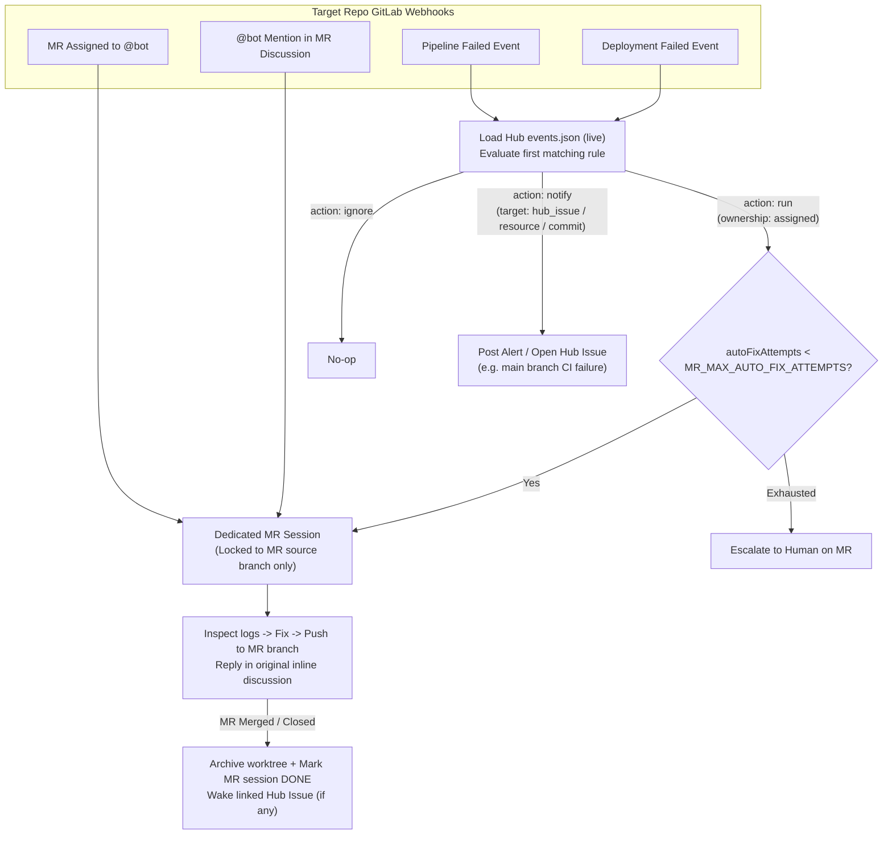
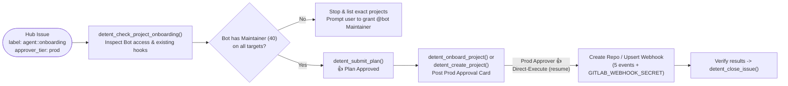
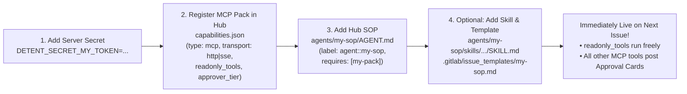

# Code Delivery, MR Workers, Onboarding & Custom SOPs

Beyond `delivery::release`, `delivery::env-change`, and `delivery::audit`, Detent ships with four additional built-in workflows—plus a zero-code extension model for creating your own SOPs and connecting external MCP servers.

---

## 1. Multi-Repo Code Delivery (`delivery::code`)

### What It Provides
Turns a single Hub Issue into a cross-repository feature implementation session (`1 Issue -> 0..N worktrees -> 0..N MRs`). Detent checks out feature branches across multiple repositories, runs tests in the ephemeral sandbox, opens linked MRs with merge order documented, tracks CI, and auto-closes once **every** linked MR is merged.

### How It Works



```mermaid
flowchart LR
    Issue(["Hub Issue\nlabel: delivery::code"]) --> Plan["Plan Mode\nInspect target repos (read-only)\ndetent_submit_plan()"]
    Plan -->|"👍 Approved"| Code["Coding Mode\ndetent_checkout_worktree() x N\nEdit + Test + detent_commit_and_push()"]
    Code --> MRs["detent_create_mr() x N\nAuto-assign @detent-bot to MRs"]
    MRs --> Merge1["Human Merges MR #1\n(MR #2 still open)"]
    Merge1 -->|"Merge Webhook:\ndefer wake-up"| WaitAll["Post progress note:\n'1 MR still open'"]
    WaitAll --> MergeN["Human Merges Last MR #N"]
    MergeN -->|"All MRs merged"| Resume["Auto-Resume Hub Issue\nVerify pipelines -> detent_close_issue()"]
```

- **Key Files**: [`examples/hub-workspace/agents/code-delivery/AGENT.md`](../../examples/hub-workspace/agents/code-delivery/AGENT.md), [`packages/core/src/workspace/mcp-tools.ts`](../../packages/core/src/workspace/mcp-tools.ts), [`packages/delivery/src/webhooks/merge-request.ts`](../../packages/delivery/src/webhooks/merge-request.ts).
- **How to Customize**: Edit Hub `agents/code-delivery/AGENT.md` and `skills/gitlab-mr-conventions/SKILL.md` to specify required test commands, commit message conventions, or change `close_policy` (`auto` / `approve` / `manual`).

---

## 2. MR Workers & Event Policy (`events.json`)

### What It Provides
Dedicated per-MR Claude sessions that operate directly on target repository Merge Requests—independent of Hub Issues:
- **Ongoing Ownership**: Assign `@detent-bot` to an open MR to monitor reviews and automatically fix failing CI pipelines (up to `MR_MAX_AUTO_FIX_ATTEMPTS`, default `3`). Unassign the bot to hand control back to humans.
- **One-Off Mention**: Mention `@detent-bot` in any MR discussion thread to run a single turn and reply inline in the exact original discussion.
- **Event Routing (`events.json`)**: Declarative first-match policy in the Hub default branch routes `pipeline` and `deployment` events to `ignore`, `notify` (comment or Hub alert Issue), `run` (trigger fix turn), or `semantic` (Jev-classified action).

### How It Works



- **Key Files**: [`packages/core/src/orchestrator/mr-orchestrator.ts`](../../packages/core/src/orchestrator/mr-orchestrator.ts), [`packages/core/src/router/event-policy.ts`](../../packages/core/src/router/event-policy.ts), [`examples/hub-workspace/events.json`](../../examples/hub-workspace/events.json).
- **How to Customize**:
  - Edit Hub `events.json` (zero restart) to add branch/project globs, `notifyTarget` (`resource` / `hub_issue` / `commit`), `hubIssueLabel`, or per-rule `maxAutoFixAttempts` (`0..10`).
  - Set `MR_MAX_AUTO_FIX_ATTEMPTS` (default `3`), `WATCHDOG_INTERVAL_MS` (default `30000`), and `WATCHDOG_MAX_RECOVERIES` (default `1`) in service env.

---

## 3. Repository Onboarding (`agent::onboarding`)

### What It Provides
Self-service GitLab repository onboarding so teams can connect new projects or entire GitLab groups to Detent without manual webhook setup:
1. Audits Bot access levels (`Maintainer >= 40` required to manage webhooks) and missing webhook events across a project or group.
2. Creates missing repositories (`detent_create_project`) or configures all 5 required webhooks (`note`, `emoji`, `merge_requests`, `pipeline`, `deployment`) via `detent_onboard_project` after **production approver** confirmation.

### How It Works



- **Key Files**: [`examples/hub-workspace/agents/onboarding/AGENT.md`](../../examples/hub-workspace/agents/onboarding/AGENT.md), [`packages/core/src/workspace/onboarding-tools.ts`](../../packages/core/src/workspace/onboarding-tools.ts).
- **How to Customize**: Enabled automatically when `DETENT_PUBLIC_URL` and `GITLAB_WEBHOOK_SECRET` are set. Edit Hub `agents/onboarding/AGENT.md` to enforce naming rules or group restrictions.

---

## 4. Image Sync (`agent::image-sync`) & Building Custom SOPs

### What It Provides
`agent::image-sync` mirrors external container images to an internal registry (e.g., Harbor) via either:
- **Zero-Config GitOps Path** (`requires: []`): Opens an MR in your GitOps sync repository and waits for CI to mirror the image.
- **External MCP Capability Path** (`requires: [harbor-sync]`): Calls a remote HTTP/SSE MCP server governed by Detent's approval cards and server-side secret injection.

### How to Add Your Own Custom SOP + External MCP Pack (Zero Detent Code Changes)



#### Step 1 — Register External MCP Pack in Hub `capabilities.json`

```json
{
  "harbor-sync": {
    "type": "mcp",
    "transport": "http",
    "url": "https://mcp.internal.example.com/harbor",
    "headers": {
      "Authorization": "Bearer ${secret:HARBOR_MCP_TOKEN}"
    },
    "approver_tier": "standard",
    "readonly_tools": ["list_images", "get_tag_digest"]
  }
}
```

- Tools listed in `readonly_tools` execute automatically without interrupting the user.
- Every **other** remote tool automatically becomes `always_approve`, posting an Approval Card governed by `approver_tier` (`standard` or `prod`).
- Secret values (`DETENT_SECRET_HARBOR_MCP_TOKEN`) are injected only in the parent process and never exposed to Claude's sandbox, logs, or GitLab comments.

#### Step 2 — Create Hub `agents/my-sop/AGENT.md`

```markdown
---
label: agent::my-sop
mode: governed
requires: [harbor-sync]
approver_tier: standard
close_policy: auto
allow_bash: false
shared_skills: [gitlab-mr-conventions]
description: Mirror verified external images into internal Harbor
---

# Custom SOP Instructions

1. Inspect the source image digest using `get_tag_digest` and submit a plan via `detent_submit_plan`.
2. After plan approval, call the governed sync tool and wait for approval.
3. Verify the mirrored digest matches and call `detent_close_issue`.
```

#### Step 3 — Verify with `/help`
Comment `/help` in any Hub Issue (zero LLM cost). Detent immediately reloads the Hub default branch and lists your new SOP along with its capability readiness status.
