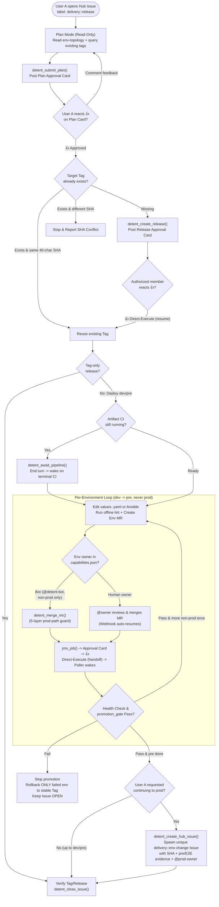
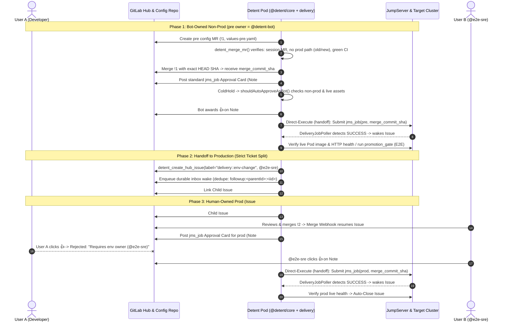
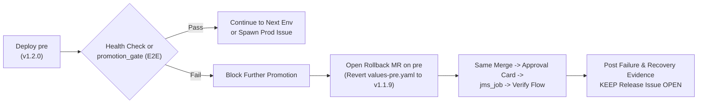

# Service Release SOP (`delivery::release`)

## 1. What It Provides

`delivery::release` is the **developer-facing, service-scoped release ticket** (User A). It handles one service from source commit lock through non-production rollout and verification, while enforcing a strict separation from production changes:

- **Commit-Locked Tag / Release**: Locks an exact 40-character Git commit SHA, reuses an existing Tag if it points to the exact same SHA (aborts on SHA conflict), or requests human approval via `detent_create_release` (supports both GitLab Release and `tag_only`).
- **Automated Non-Prod Rollout (`dev` -> `pre`)**: When non-prod environments are owned by `@detent-bot`, the bot autonomously creates the config MR, runs offline lint (`helm lint` / `yamllint`), merges the MR via `detent_merge_mr`, approves its own `jms_job` card with 👍, deploys, verifies health, and runs `promotion_gate` (e.g. cross-repo E2E).
- **Hard Boundary at `pre`**: A `delivery::release` ticket **never modifies `prod` directly**.
  - If User A only requested up to `dev` or `pre` -> verifies and auto-closes.
  - If User A requested continuing to `prod` (e.g., urgent bugfix or end-to-end release) -> after `pre` and `promotion_gate` pass, Detent automatically spawns a **unique child `delivery::env-change` Issue** containing the locked Tag, full SHA, `pre` evidence, and `@prod-owner` mention, links it back, and closes the release Issue.
- **Automatic Failure Containment**: If deployment, health verification, or `promotion_gate` fails, promotion stops immediately, only the failed environment is rolled back to the previously recorded stable Tag, and the release Issue stays open for human decision.

---

## 2. How It Works

### 2.1 End-to-End Service Release Flow



### 2.2 Bot-Owned Non-Prod vs. Human-Owned Prod (100% Pipeline Reuse)

Both non-prod (`@detent-bot`) and prod (`@sre-owner`) run through the **exact same approval card, emoji audit trail, and direct-execute engine**—there is no bypass path.



### 2.3 Failure & Auto-Rollback Branch



---

## 3. Implementation Map (Under the Hood)

| Layer | File | Responsibility |
| :--- | :--- | :--- |
| **SOP Instructions** | [`examples/hub-workspace/agents/release/AGENT.md`](../../examples/hub-workspace/agents/release/AGENT.md) | Defines `label: delivery::release`, `mode: governed`, `requires: [gitlab-release]`, `close_policy: auto`, and step-by-step release logic. |
| **Environment Contract** | [`examples/hub-workspace/skills/env-topology/SKILL.md`](../../examples/hub-workspace/skills/env-topology/SKILL.md) | Single-environment change steps, `dev -> pre -> prod` matrix, `promotion_gate`, and predecessor rules. |
| **Release & Pipeline Tools** | [`packages/core/src/workspace/release-tools.ts`](../../packages/core/src/workspace/release-tools.ts) | `detent_list_tags`, `detent_create_release` (`directExecuteOnApproval: 'resume'`), `detent_trigger_pipeline`, `detent_await_pipeline`. |
| **Bot Merge Guard** | [`packages/core/src/workspace/mcp-tools.ts`](../../packages/core/src/workspace/mcp-tools.ts) + [`packages/delivery/src/agents/profiles.ts`](../../packages/delivery/src/agents/profiles.ts) | `detent_merge_mr` verifies session ownership, live MR state, `changes_count === diffs.length`, green pipeline, Bot-owned non-prod env, and regex-blocks any `prod`/`production` path in both `old_path` and `new_path`. |
| **Bot Auto-Approve** | [`packages/core/src/orchestrator/session-orchestrator.ts`](../../packages/core/src/orchestrator/session-orchestrator.ts) | Intercepts `ColdHold` when `shouldAutoApproveAsBot` is true -> awards 👍 on original card -> runs `executeApprovedTool('handoff')`. |
| **Follow-up Spawning & Anti-Loop** | [`packages/core/src/orchestrator/session-orchestrator.ts`](../../packages/core/src/orchestrator/session-orchestrator.ts) + [`packages/core/src/gitlab/client.ts`](../../packages/core/src/gitlab/client.ts) + [`packages/core/src/db/repository.ts`](../../packages/core/src/db/repository.ts) | `detent_create_hub_issue` is only exposed on non-child `delivery::release` sessions. Triple idempotency: DB `getFollowupSession` -> GitLab `findFollowupIssue` (marker + `isBotUser` check) -> durable `session_inbox` wake (`followup:<parentId>:<iid>`). |

---

## 4. How to Customize It

### 4.1 Change Tag Naming or Release Notes Format *(Hub Edit, Zero Restart)*
Edit `agents/release/AGENT.md` in your Hub repository (e.g., require `rel-YYYYMMDD-N` prefix or enforce `tag_only: true`). Takes effect on the very next turn.

### 4.2 Enable Cross-Repo E2E as `promotion_gate` *(Hub Edit, Zero Restart)*
Edit `skills/env-topology/SKILL.md` in your Hub repository and replace the `pre` row's `promotion_gate`:

```markdown
| Env | Helm Values / Ansible Inventory | JumpServer Node / Label | promotion_gate |
| --- | --- | --- | --- |
| dev | `values-dev.yaml` | `/DEFAULT/dev` / `env:dev` | None |
| pre | `values-pre.yaml` | `/DEFAULT/pre` / `env:pre` | Run `detent_trigger_pipeline({ project: "qa/platform-e2e", ref: "main", variables: { RELEASE_TAG: "<Tag>" } })`; wait for `success` callback before spawning prod |
| prod | `values-prod.yaml` | `/DEFAULT/prod` / `env:prod` | None |
```

### 4.3 Control Who Owns Each Environment *(Hub Edit, Zero Restart)*
Edit `capabilities.json` in your Hub repository:

```json
{
  "jumpserver": {
    "environments": {
      "dev":  { "match": ["/DEFAULT/dev", "label:env:dev"], "approver_tier": "standard", "owner": "@detent-bot" },
      "pre":  { "match": ["/DEFAULT/pre", "label:env:pre"], "approver_tier": "standard", "owner": "@detent-bot" },
      "prod": { "match": ["/DEFAULT/prod", "label:env:prod"], "approver_tier": "prod", "owner": ["@sre-alice", "@sre-bob"] }
    }
  }
}
```

- Want a human QA lead to approve `pre` instead of Bot? Change `"owner": "@qa-lead"`.
- Trying to set `"owner": "@detent-bot"` on `prod` (or any `approver_tier: "prod"` environment) is **hard-blocked** at both config load and runtime.

### 4.4 Require Prod Approver for Tag Creation *(Hub Edit, Zero Restart)*
In Hub `capabilities.json`, change `gitlab-release.approver_tier` from `"standard"` to `"prod"`.

### 4.5 Disable Release Tools Globally *(Server Env)*
Set `DELIVERY_ENABLE_RELEASE_TOOLS=false` in the Delivery service environment. Any `delivery::release` Issue will fail fast before calling Claude and report the setup hint.
